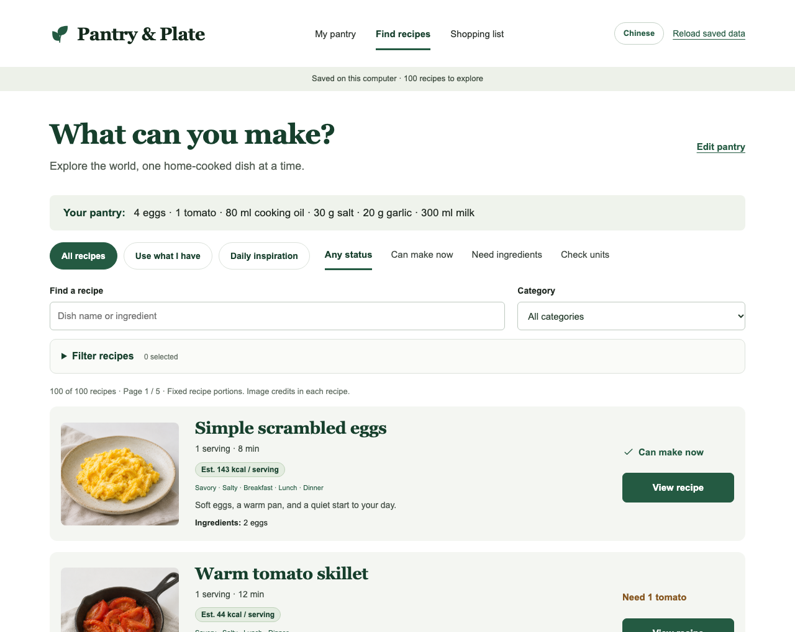
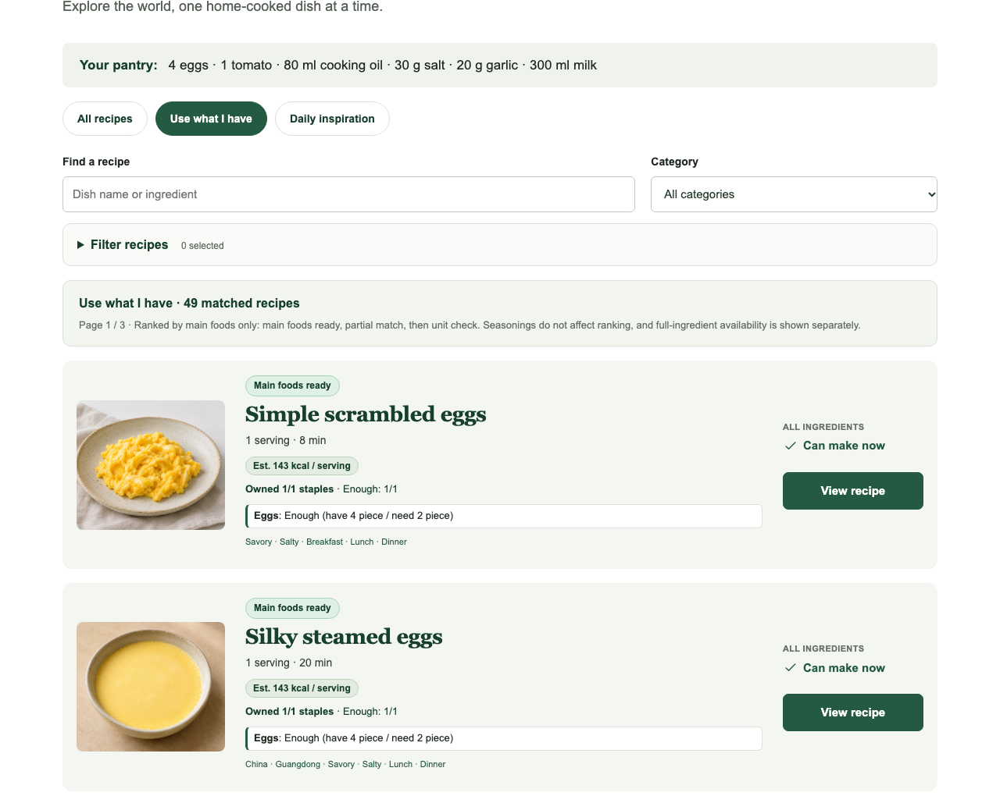
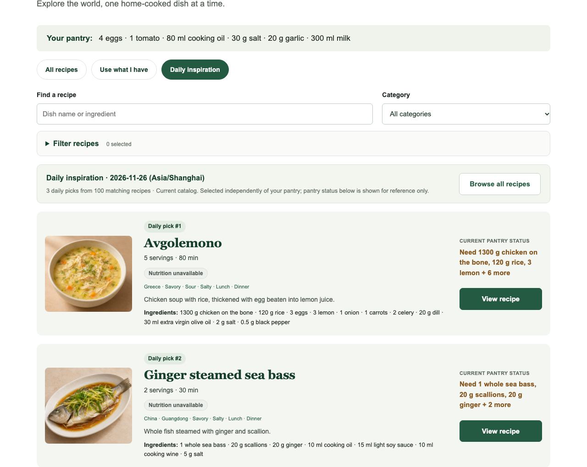
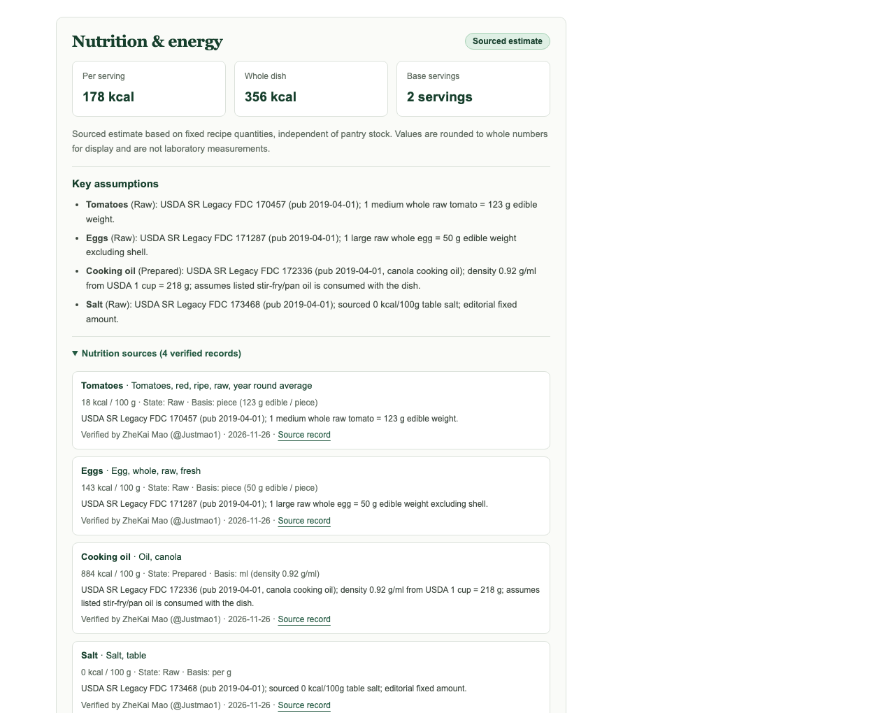
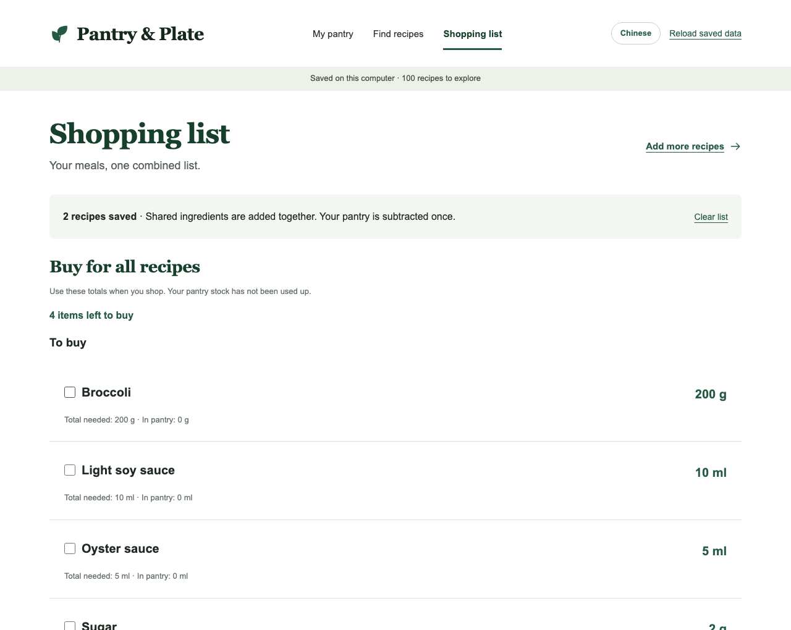
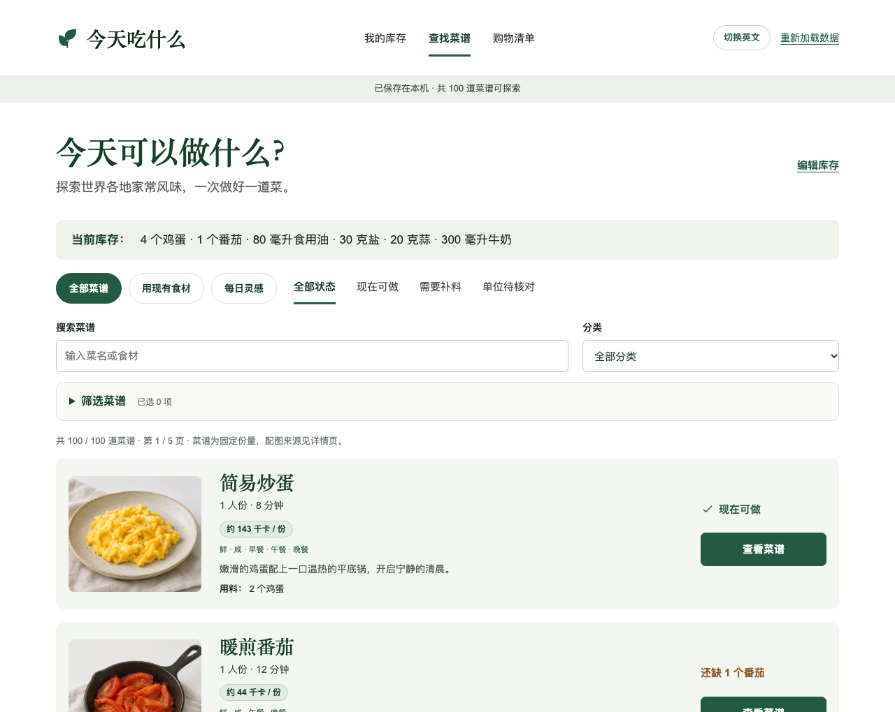
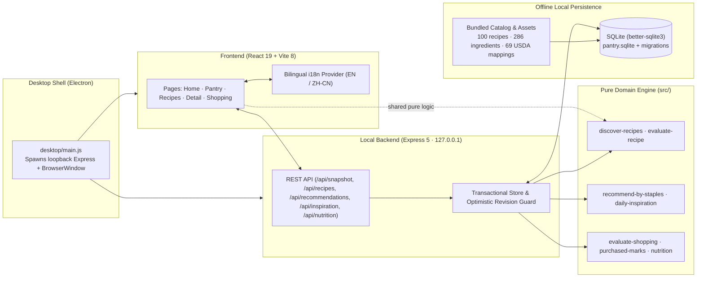

<div align="center">


# Pantry & Plate

### Smart Recipe & Pantry Planner

**An offline-first, bilingual desktop & local web app that turns what is already in your kitchen into illustrated recipes, verified nutrition estimates, and combined shopping lists.**

[](https://github.com/kekepepe/Smart-Recipe-Pantry-Planner/actions/workflows/test.yml)
[](https://github.com/kekepepe/Smart-Recipe-Pantry-Planner/actions/workflows/desktop.yml)
[](https://github.com/kekepepe/Smart-Recipe-Pantry-Planner/releases/latest)
[](#download-desktop-app)
[](.nvmrc)
[](LICENSE)

[**Download v1.0.0**](https://github.com/kekepepe/Smart-Recipe-Pantry-Planner/releases/latest) · [**Features**](#features) · [**Screenshots**](#interface-showcase) · [**Quick Start**](#run-from-source) · [**Architecture**](#architecture) · [**Documentation**](#documentation)

**English** | [简体中文](README.zh-CN.md)

</div>

---

## Why Pantry & Plate?

Home cooks frequently have ingredients on hand yet still spend time manually cross-checking recipes, guessing quantities, and scribbling shopping lists. **Pantry & Plate** connects your local kitchen inventory, a curated 100-recipe world catalog, sourced nutrition estimates, and a multi-recipe shopping list in one calm, private, offline-first workspace—no accounts, no cloud tracking, and no fabricated data.

<p align="center">
  
</p>

---

## Features

| Capability | What it does |
| --- | --- |
| **Local Pantry Management** | Track **286 canonical ingredients** split into **174 main foods** and **112 seasonings** with strict unit validation (`g`, `ml`, `piece`), instant search, edit/delete confirmation, and local SQLite persistence. |
| **100-Recipe Multi-Dimensional Discovery** | Filter **100 illustrated world recipes** across **16 countries**, **15 regional cuisines**, **6 tastes**, **3 meals**, category, availability status (`Any status`, `Can make now`, `Need ingredients`, `Check units`), and bilingual keyword search. URL-persisted queries survive reload and back navigation. |
| **Use What I Have (Staple Recommendations)** | Ranks matching dishes by **main food coverage** (`Main foods ready`, `Partial staple match`, `Check staple units`) with per-staple stock breakdowns, while surfacing missing seasonings separately so you never miss a dish for lack of one spice. |
| **Daily Inspiration** | Serves **3 deterministic daily picks** per `Asia/Shanghai` calendar day, completely independent of pantry inventory while respecting active cuisine/taste/meal filters. |
| **Verified USDA Nutrition Estimates** | Displays per-serving and whole-dish `kcal`, base servings, cooking-state assumptions, and expandable **USDA FoodData Central (SR Legacy)** source citations (**69 verified mappings** covering **21 complete recipes**). Unmapped dishes explicitly display `Unavailable`—never fabricated `0 kcal`. |
| **Multi-Recipe Shopping List & Purchased Marks** | Save multiple recipes into one combined list, sum shared ingredients before subtracting pantry stock once, and check off **Purchased** items that persist across refreshes/restarts without mutating pantry stock. Automatically flags quantity changes and unit conflicts. |
| **Full EN / 简体中文 Bilingual UI** | One-click language switcher persisted in `localStorage` with pre-paint `<html lang>` sync and 100% localized recipes, ingredients, taxonomy, nutrition labels, and status messages. |
| **Offline Desktop App (macOS & Windows)** | Packaged Electron desktop app with bundled Node/Express local server, native SQLite (`better-sqlite3`), automatic schema migrations, and pre-upgrade database backups. |

---

## Interface Showcase

<table>
  <tr>
    <td width="50%" valign="top">
      <strong>Use What I Have (Staple Recommendations)</strong><br />
      <em>Ranks dishes by main foods on hand with per-ingredient stock breakdowns.</em>
      
    </td>
    <td width="50%" valign="top">
      <strong>Daily Inspiration</strong><br />
      <em>Deterministic daily 3-dish suggestions independent of pantry stock.</em>
      
    </td>
  </tr>
  <tr>
    <td width="50%" valign="top">
      <strong>Verified USDA Nutrition &amp; Energy Provenance</strong><br />
      <em>Per-serving &amp; whole-dish kcal, assumptions, and expandable USDA FDC records.</em>
      
    </td>
    <td width="50%" valign="top">
      <strong>Multi-Recipe Shopping List &amp; Purchased Marks</strong><br />
      <em>Combines shared shortages across recipes with persistent purchased checkboxes.</em>
      
    </td>
  </tr>
</table>

<details>
<summary><strong>Preview Simplified Chinese (简体中文) Interface</strong></summary>

<p align="center">
  
</p>

</details>

---

## Download Desktop App

Pre-built offline installers for **macOS (Apple Silicon)** and **Windows (x64)** are published on [**GitHub Releases**](https://github.com/kekepepe/Smart-Recipe-Pantry-Planner/releases/latest) along with `SHA256SUMS.txt` and `SOURCE_COMMIT.txt`.

| Platform | Target OS / Arch | Installer Asset | Notes |
| --- | --- | --- | --- |
| **macOS** | macOS 15+ (`arm64` Apple Silicon) | `Pantry-and-Plate-1.0.0-dev-mac-arm64.dmg` | Drag **Pantry & Plate** to Applications. Uses ad-hoc signing (not notarized): on first launch, use **Right-click → Open** or allow in *System Settings → Privacy & Security*. |
| **Windows** | Windows 11 (`x64`) | `Pantry-and-Plate-1.0.0-dev-win-x64.exe` | Run the NSIS installer (or silent per-user install: `/S /currentuser`). Unsigned build: verify `SHA256SUMS.txt`, then choose **More info → Run anyway** if SmartScreen prompts. |

> [!NOTE]
> **Local Data Storage & Automatic Upgrade Backups**
> All pantry items, shopping selections, and purchased marks stay strictly on your machine:
> - **macOS:** `~/Library/Application Support/Pantry & Plate/pantry.sqlite`
> - **Windows:** `%APPDATA%\Pantry & Plate\pantry.sqlite`
>
> Before applying a schema or catalog upgrade, the app automatically writes a timestamped backup (`pantry-before-upgrade-*.sqlite`) in the same folder.

---

## Run from Source

### Prerequisites

- **Node.js `22.23.1`** (pinned in [`.nvmrc`](.nvmrc); engine range `>=22.12.0 <23`)
- **npm** (bundled with Node.js)

### Quick Start (Local Web App)

```bash
git clone https://github.com/kekepepe/Smart-Recipe-Pantry-Planner.git
cd Smart-Recipe-Pantry-Planner
npm ci
npm run db:init
npm run dev
```

Open **[http://127.0.0.1:5173/](http://127.0.0.1:5173/)** in your browser.

### Production Local Server

```bash
npm run build
npm start
```

Serves the complete compiled app and SQLite API at **[http://127.0.0.1:3001/](http://127.0.0.1:3001/)**.

### Package Desktop Installer Locally

```bash
npm run package:desktop
```

See [docs/desktop-packaging.md](docs/desktop-packaging.md) for platform flags (`--mac --arm64`, `--win --x64`) and smoke-test instructions (`node desktop/smoke.js`).

### Database CLI Utilities

```bash
npm run db:init      # Initialize SQLite database, run migrations, and seed catalog
npm run db:migrate   # Apply pending SQLite schema migrations
npm run db:seed      # Re-sync recipe/ingredient catalog
npm run db:backup    # Create a local SQLite backup
npm run db:restore   # Restore from a backup snapshot
npm run db:repair    # Rebuild derived shopping cache while preserving user marks
```

---

## Architecture



### Tech Stack

| Layer | Technology |
| --- | --- |
| **Frontend** | React 19, Vite 8, custom accessible CSS, hash routing, zero runtime external API dependencies |
| **Backend** | Node.js 22 (ESM), Express 5 (loopback-only with same-origin CSRF protection), transactional `Store` with optimistic concurrency (`expectedRevision`) |
| **Database** | SQLite via `better-sqlite3` with versioned SQL migrations (`001`–`004`), foreign-key/check constraints, and backup/repair CLI |
| **Desktop** | Electron 45 + `electron-builder` 26 (`macOS arm64 DMG`, `Windows x64 NSIS`) |
| **Testing & CI** | Node built-in test runner (`node --test`), Playwright Chromium E2E, GitHub Actions 3-OS matrix (`Ubuntu`, `macOS`, `Windows`) |

### Project Layout

```text
Smart-Recipe-Pantry-Planner/
├── data/                  # 100-recipe catalog, 286 ingredients, USDA nutrition mappings & source snapshots
├── desktop/               # Electron main process, electron-builder config, packaged smoke test
├── docs/                  # Contracts, runbooks, PRD, nutrition audit, packaging guide & screenshots
├── public/                # App favicon and 100 bundled recipe illustrations
├── scripts/               # Dev runner, DB CLI (init/migrate/seed/backup/restore/repair), verifiers
├── server/                # Express loopback API, SQLite schema/migrations, transactional Store service
├── src/                   # Pure deterministic domain modules (matching, discovery, shopping, nutrition)
├── tests/                 # Unit/rules, API, DB integration, and Playwright E2E suites
└── web/                   # React UI pages, components, styles, and EN/ZH-CN i18n dictionary
```

---

## Testing & Quality Assurance

Run the full verification suite locally (install Playwright Chromium once if running E2E for the first time):

```bash
npx playwright install chromium
npm run check:v1   # Alias: npm run check:v2
```

`npm run check:v1` runs six sequential quality gates:

1. **`npm run test:final`** — Completion precheck + pure domain/rules unit tests (shortage math, multi-recipe aggregation, discovery filters, staple recommendations, daily inspiration, purchased marks, USDA nutrition math, and 286-ingredient / 100-recipe pure-Chinese i18n checks).
2. **`npm run demo`** — End-to-end deterministic shortage demonstration.
3. **`npm run test:api`** — Express REST API contract, validation, optimistic concurrency (`409`), and error-handling tests.
4. **`npm run test:integration`** — Real SQLite process-restart durability, migration (`003`→`004`), backup/restore, repair, and atomic rollback tests.
5. **`npm run build`** — Production Vite client bundle verification.
6. **`npm run test:e2e`** — Playwright Chromium browser tests across desktop & mobile viewports (onboarding, pantry CRUD, discovery, staple recommendations, daily inspiration, purchased marks, USDA nutrition UI, and strict EN/ZH-CN language isolation).

Continuous Integration runs automatically on GitHub Actions:
- [**V1 checks**](.github/workflows/test.yml): Ubuntu (full suite + Playwright Chromium), macOS, and Windows.
- [**Desktop installer candidates**](.github/workflows/desktop.yml): Builds and smoke-tests `macos-arm64` DMG and `windows-x64` NSIS installers.

---

## Honest Scope & Data Provenance

Pantry & Plate prioritizes **correctness and transparency** over inflated claims:

- **Strict Unit Integrity:** Pantry matching and shopping totals never silently guess conversions between `g`, `ml`, and `piece`. Incompatible units are explicitly flagged as **Check units** rather than producing misleading numbers.
- **Fail-Closed Nutrition Estimates:** Calorie estimates are computed strictly from verified **USDA FoodData Central (SR Legacy)** entries ([`docs/NUTRITION-SOURCES.md`](docs/NUTRITION-SOURCES.md)). Currently **21 of 100 recipes** have complete verified coverage (**69 ingredient mappings**); the remaining **79 recipes** explicitly display `Unavailable` with unmapped required ingredients listed—never partial totals or fabricated `0 kcal`.
- **No Silent Pantry Mutation:** Checking off an item as **Purchased** in the shopping list records your shopping progress without silently modifying pantry quantities.
- **No Cloud Dependency:** All data, catalog entries, nutrition tables, and 100 illustrations are bundled locally.

---

## Documentation

| Category | Document |
| --- | --- |
| **Operations & Packaging** | [V2 Source Runbook](docs/V2-RUNBOOK.md) · [Desktop Packaging Guide](docs/desktop-packaging.md) · [V1 Runbook](docs/V1-RUNBOOK.md) |
| **Feature Contracts** | [Staple Recommendations](docs/STAPLE-RECOMMENDATIONS-CONTRACT.md) · [Daily Inspiration](docs/DAILY-INSPIRATION-CONTRACT.md) · [Purchased Marks](docs/PURCHASED-MARKS-CONTRACT.md) · [Nutrition Contract](docs/NUTRITION-CONTRACT.md) · [Multi-Recipe Shopping](docs/V1-MULTI-RECIPE.md) |
| **Data & Provenance** | [USDA Nutrition Sources Audit](docs/NUTRITION-SOURCES.md) · [Recipe Catalog & Sources](docs/RECIPE-CATALOG.md) · [V2 Discovery Guide](docs/V2-DISCOVERY.md) |
| **Product & Planning** | [PRD (EN)](docs/PRD.md) · [PRD (ZH-CN)](docs/PRD.zh-CN.md) · [V2 Development Plan (ZH-CN)](docs/V2-DEVELOPMENT-PLAN.zh-CN.md) · [Iteration 1 Summary (ZH-CN)](docs/iteration-1-report.zh-CN.md) |

---

## Contributing

Contributions, bug reports, and verified USDA nutrition mappings are welcome! Please read **[CONTRIBUTING.md](CONTRIBUTING.md)** for setup instructions, branch/PR conventions, and verification requirements before opening a pull request.

### Project Team

Built collaboratively by:
- **Peng Ke** ([@kekepepe](https://github.com/kekepepe))
- **ChangPeng Shi** ([@Lsiav](https://github.com/Lsiav))
- **HaoZhe Feng** ([@fhhhz-todd](https://github.com/fhhhz-todd))
- **ZheKai Mao** ([@Justmao1](https://github.com/Justmao1))

---

## License & Acknowledgments

- **Source Code:** Licensed under the **[MIT License](LICENSE)**.
- **Third-Party Recipe & Nutrition Data (Separate Licenses & Provenance):**
  - 18 home-style recipes adapted from [Anduin2017/HowToCook](https://github.com/Anduin2017/HowToCook) (**Unlicense**, snapshots in `data/sources/howtocook/`).
  - 80 world recipes adapted from [UniTools Recipes](https://github.com/farcrak/unitools-recipes) (**CC BY-SA 4.0**, attribution: *UniTools — theunitools.com*; `data/world-recipes.json` remains under **CC BY-SA 4.0** and is not relicensed under MIT).
  - 69 nutrition mappings sourced from **USDA FoodData Central — SR Legacy** (Public Domain / CC0 1.0; full audit in [`docs/NUTRITION-SOURCES.md`](docs/NUTRITION-SOURCES.md)).
  - 100 bundled recipe illustrations generated for this project with provenance recorded in `data/world-image-manifest.json`.
