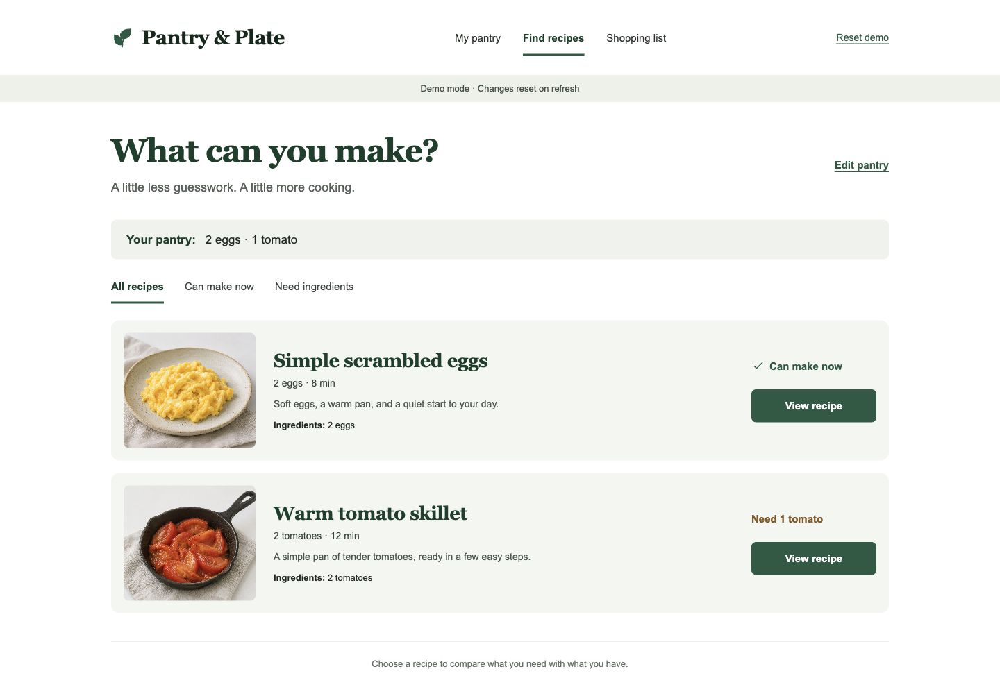
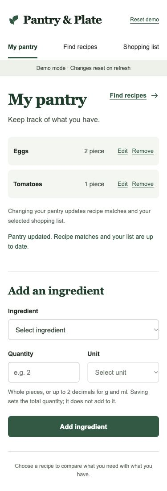
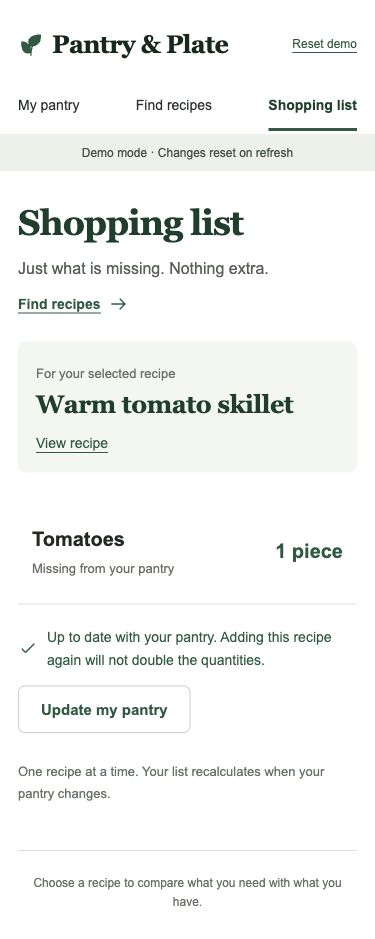

# Smart Recipe & Pantry Planner

**V1 development build:** `feat/v1-core` implements local persistence and 20 illustrated recipes. [Run guide](docs/V1-RUNBOOK.md) · [Technical acceptance](docs/V1-ACCEPTANCE.md) · [Plan](docs/V1-DEVELOPMENT-PLAN.zh-CN.md) · [Recipe sources](docs/RECIPE-CATALOG.md) · [Release status](docs/V1-RELEASE.md). Peer review, independent member reproduction and real-user evaluation remain outstanding.

[English](README.md) | [简体中文](README.zh-CN.md)

A software project to help home cooks manage ingredients, discover recipes, identify missing ingredients, and prepare grocery lists.

**Status: supervised local V1 development baseline.** React/Vite now reads and writes SQLite through Express. Pantry and multi-recipe lists survive refresh and service restart. V2 and a multi-user hosted pilot remain separate work.

**Repository:** [kekepepe/Smart-Recipe-Pantry-Planner](https://github.com/kekepepe/Smart-Recipe-Pantry-Planner)

## Interface preview

Actual screenshots of the running V0 prototype, using the two-eggs/one-tomato demo. These are rendered application screens, not the design concept. The interface currently uses English.

### Desktop recipe matching



### Mobile pantry and shopping list

| My pantry | Shopping list |
| --- | --- |
|  |  |

## Why this project

People often have ingredients at home but are unsure what to cook. Browsing recipe websites still requires them to compare ingredients manually and write down what is missing. This project aims to connect pantry management, recipe selection, and shopping preparation in one workflow, helping users save time, avoid unnecessary purchases, and reduce food waste.

## Intended users and stakeholders

| Stakeholder | Main need |
| --- | --- |
| Home cooks | Find recipes using ingredients already available at home. |
| Students and busy workers | Spend less time deciding what to cook and preparing shopping lists. |
| Health-conscious users | View estimated calories to support everyday food choices. |
| Development team | Work with clear requirements, testable features, and maintainable code. |
| System administrator | Maintain recipe records and basic system data, and monitor errors. |

## Historical V0 prototype

- Start with two eggs and one tomato, or enter your own pantry.
- Add, edit and delete canonical ingredients and quantities.
- Browse two sample recipes, compare required and available amounts, and distinguish ready recipes from shortages or incompatible units.
- Generate an idempotent single-recipe shopping list that updates with pantry changes and never consumes stock.
- Use responsive pages, keyboard-accessible controls and confirmation dialogs. Refresh resets the session.

[Implementation plan in Chinese](docs/V0-IMPLEMENTATION-PLAN.zh-CN.md) · [Design reference and assets](docs/design/V0-DESIGN.md)

## Version features

### V1 — Local core MVP implemented on the development branch

- **Pantry management:** add, edit, and remove ingredients, including their quantities.
- **Recipe browsing:** view recipes, required ingredients, and basic cooking instructions.
- **Pantry-based matching:** separate recipes into “can make now” and “can make after buying missing ingredients”.
- **Shopping list:** persist several recipes, show individual gaps and combined buying totals, sum requirements before subtracting shared stock once, and remove individual recipes or clear the list. [Behavior and migration](docs/V1-MULTI-RECIPE.md).

The core user journey is: **record pantry ingredients → browse matching recipes → inspect missing ingredients → generate a shopping list**.

### V2 — Enhanced application

- **Daily recommendations:** suggest recipes independently of the current pantry inventory.
- **Calorie estimates:** show estimated total and per-serving calories based on recipe ingredients.
- **Improved shopping lists:** combined multi-recipe totals have moved into V1; purchased status and further convenience improvements remain future work.
- **Feedback-driven improvements:** refine matching, filters, and usability based on V1 evaluation.
- **Optional, time permitting:** ingredient expiry reminders.

### Out of scope

- Training a custom AI model.
- Online ordering, payment, or delivery management.
- Professional medical nutrition advice.

The application will prepare grocery lists; it will not process purchases. Calorie values are intended as estimates for everyday reference.

## Development approach and roadmap

The project follows **Iterative-Incremental Development**. V1 will provide a complete core workflow. User evaluation will then guide improvements and additional features in V2. Each release should be usable and demonstrable.

| Stage | Planned work | Expected output |
| --- | --- | --- |
| V0 preparation and Day 1 review | Prepare the local prototype, then review reusable code, requirements and the candidate stack on formal Day 1. | Runnable prototype, technical checks and prioritized backlog. |
| Iteration 1 — V1 | Build pantry management, recipe browsing and matching, and missing-ingredient lists. | Working MVP and core test cases. |
| User evaluation | Ask sample users to complete common tasks and record defects and feedback. | Evaluation summary and revised V2 backlog. |
| Iteration 2 — V2 | Improve V1 and add daily recommendations, calorie estimates, and shopping-list enhancements. | Enhanced application, regression tests, and demonstration. |

V0 has been integrated into main. This branch extends it with the local V1 core. The two five-working-day iterations remain the team plan; implementation does not replace independent reproduction or user evaluation.

## Release acceptance goals

These are product acceptance goals. Completed technical checks are recorded in V1-ACCEPTANCE; user evaluation and release gates are listed separately.

**V1**

- Users can save pantry ingredients and quantities, then update or remove them.
- Users can view recipe ingredients and cooking instructions.
- Users can distinguish recipes they can make now from those requiring additional ingredients.
- Users can obtain a shopping list of missing ingredients.

**V2**

- Users can receive daily recipe suggestions independently of their pantry inventory.
- Users can view estimated total and per-serving calories.
- Users can combine missing ingredients across selected recipes and mark grocery items as purchased.
- Core V1 tasks continue to work after the enhancements.

## Getting started

Use Node.js 22.23.1 from `.nvmrc`:

```bash
git clone --branch feat/v1-core https://github.com/kekepepe/Smart-Recipe-Pantry-Planner.git
cd Smart-Recipe-Pantry-Planner
npm ci
npm run db:init
npm run dev
```

Open [the development app](http://127.0.0.1:5173/). After `npm run build`, `npm start` serves the complete app at [127.0.0.1:3001](http://127.0.0.1:3001/). Vite `preview` is static-only and does not replace the V1 server.

```bash
npx playwright install chromium
npm run check:v1
```

See the [run guide](docs/V1-RUNBOOK.md) for configuration, migrations, failure recovery and backups. Database files stay local. These commands select the development branch; see [release status](docs/V1-RELEASE.md) for review and main integration.

## Planning references

This README is based on the supplied planning documents:

- `Smart_Recipe_and_Pantry_Planner_Project_Planning_Revised_task2.docx` — English planning document.
- `Smart_Recipe_and_Pantry_Planner_Project_Planning_CN_Revised_task2.docx` — Chinese planning document.

The documents define stakeholders, release scope, the problem statement, the selected development approach, and success criteria. Their original files are preserved separately from this README.
