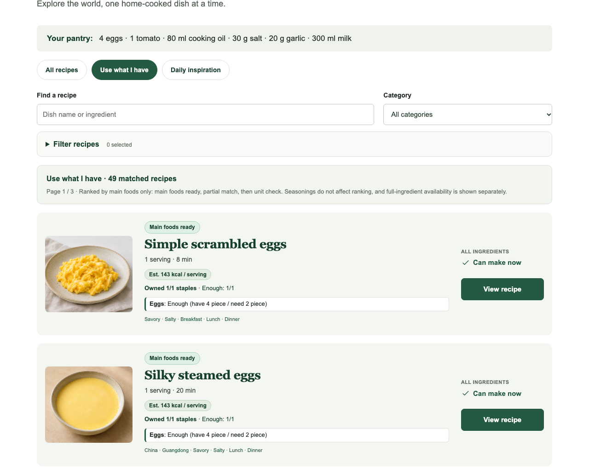
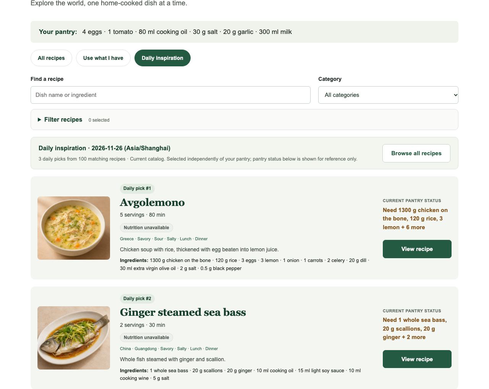
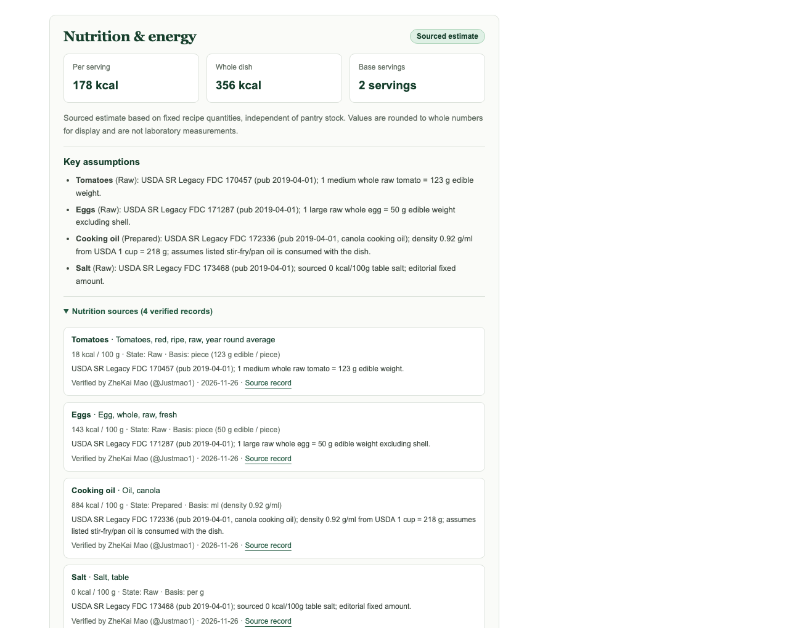
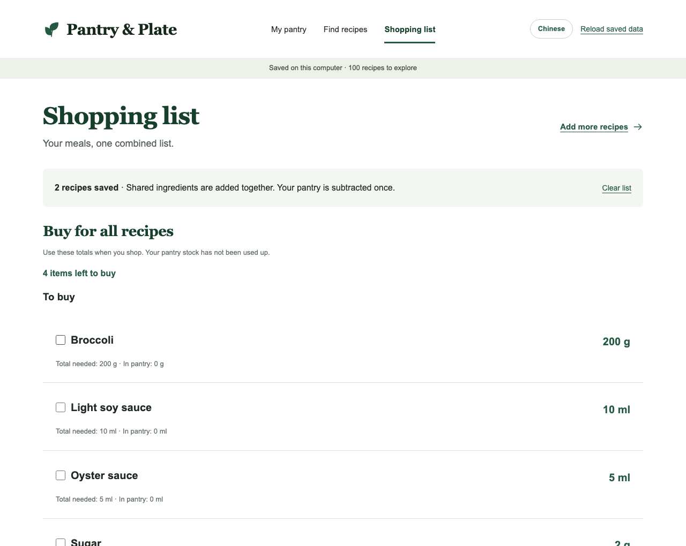
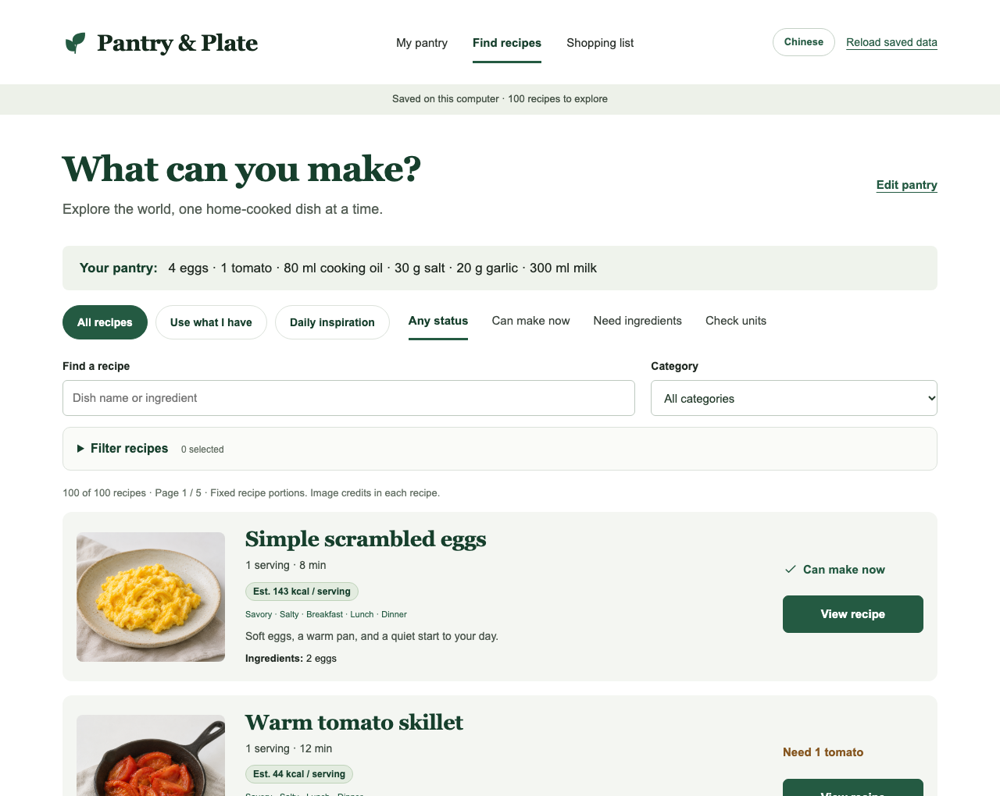
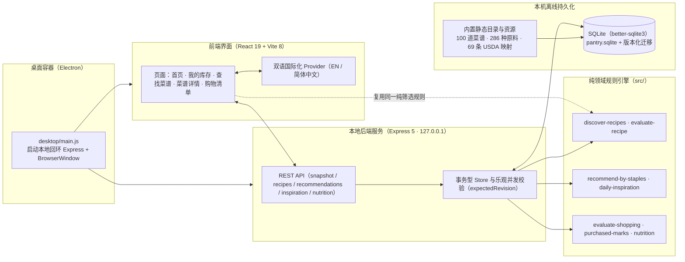

<div align="center">


# 今天吃什么 · Pantry & Plate

### Smart Recipe & Pantry Planner（智能菜谱与库存规划工具）

**一款离线优先、完整中英双语的桌面与本地 Web 应用：将家中现有食材转化为 100 道带图菜谱、有据可查的热量估算与多菜合并购物清单。**

[](https://github.com/kekepepe/Smart-Recipe-Pantry-Planner/actions/workflows/test.yml)
[](https://github.com/kekepepe/Smart-Recipe-Pantry-Planner/actions/workflows/lite.yml)
[](https://github.com/kekepepe/Smart-Recipe-Pantry-Planner/actions/workflows/desktop.yml)
[](https://github.com/kekepepe/Smart-Recipe-Pantry-Planner/releases/latest)
[](#下载桌面客户端)
[](.nvmrc)
[](LICENSE)

[**下载 v1.0.3**](https://github.com/kekepepe/Smart-Recipe-Pantry-Planner/releases/latest) · [**核心特性**](#核心特性) · [**界面展示**](#界面展示) · [**源码运行**](#源码运行) · [**系统架构**](#系统架构) · [**文档索引**](#文档索引)

[English](README.md) | **简体中文**

</div>

---

## 为什么做这个项目？

许多人家中已有不少食材，却总在纠结“今天做什么”，浏览普通菜谱网站时仍要逐项核对库存、手写缺料清单。**今天吃什么（Pantry & Plate）** 将本地食材库存、100 道世界家常菜谱库、经核验的 USDA 热量估算和多菜合并购物清单整合进一个清爽、私密、完全离线可用的工作台——无需注册账号、无云端追踪、绝不编造营养或库存数据。

<p align="center">
  
</p>

---

## 核心特性

| 模块 | 功能说明 |
| --- | --- |
| **本地库存管理** | 内置 **286 种规范原料**，清晰区分为 **174 种主食材** 与 **112 种调料**；严格校验数量与单位（`克` / `毫升` / `个`），支持即时搜索、编辑、删除确认，并持久化保存至本机 SQLite。 |
| **100 道带图菜谱与多维检索** | 覆盖 **16 个国家**、**15 种地区菜系**、**6 种口味**、**3 种餐次**、原分类、可做状态（`全部状态` / `现在可做` / `需要补料` / `单位待核对`）及中英文关键词检索；筛选状态保存在 URL 中，刷新或详情返回不丢失。 |
| **用现有食材（主食材推荐）** | 仅依据**主食材匹配度**排序（`主食材齐备`、`部分主食材匹配`、`主食材单位待核对`），逐项展示库存对比并单独标注所缺调料，避免因为少一味调料而错过好菜。 |
| **每日灵感** | 按 `Asia/Shanghai` 自然日提供 **3 道确定性每日推荐**，选菜完全不受当前库存限制，同时共享当前激活的国家/地区/口味/餐次筛选条件。 |
| **经核验的 USDA 热量估算** | 展示每份与整道菜的估算千卡、基础份数、烹调状态假设，以及可展开追溯的 **USDA FoodData Central (SR Legacy)** 原始记录（**69 条核验映射**覆盖 **21 道完整菜谱**）；其余未覆盖菜谱诚实标示为 `暂无数据`，绝不显示伪造的 `0 千卡`。 |
| **多菜合并购物清单与已购状态** | 支持同时保存多道菜谱，先汇总共同食材需求再统一扣除一次库存；支持勾选/撤销 **已购** 状态且跨刷新/重启保留，**不会**擅自修改库存；当菜谱用量变更或出现单位冲突时自动提示重新核对。 |
| **完整中英双语界面** | 右上角一键切换英文 / 简体中文并本地持久化，结合首屏前 `<html lang>` 同步脚本，实现 100 道菜谱、286 种原料、分类标签与营养说明的全量本地化。 |
| **本地离线登录与自动登录** | 支持按本机 SQLite 数据库设置本地账号与哈希密码，提供「记住登录」（30 天可撤销凭据自动登录）与修改密码；从旧版升级后自动保留全部库存与购物清单数据。 |
| **离线轻量版（Lite）与桌面版** | **Lite 原生轻量安装包（`v1.0.3`，约 28 MB `.dmg` / `.exe`）**复用本机 Node.js（`22.14+` 的 `22.x`）与默认浏览器，无终端黑框、支持菜单栏/托盘控制及一键应用内增量更新与失败自动回滚；未安装 Node.js 的电脑仍可下载 `v1.0.1` 完整 Electron 离线安装包。 |

---

## 界面展示

<table>
  <tr>
    <td width="50%" valign="top">
      <strong>用现有食材（主食材推荐）</strong><br />
      <em>按家中主食材覆盖率排序，清晰展示每项主食材缺口与完整可做状态。</em>
      
    </td>
    <td width="50%" valign="top">
      <strong>每日灵感</strong><br />
      <em>按上海时区每日稳定推荐 3 道菜，独立于库存并给出参考缺料提示。</em>
      
    </td>
  </tr>
  <tr>
    <td width="50%" valign="top">
      <strong>USDA 热量估算与数据溯源</strong><br />
      <em>每份/整道菜千卡、关键假设与可展开的 USDA SR Legacy 原始记录。</em>
      
    </td>
    <td width="50%" valign="top">
      <strong>多菜合并购物清单与已购勾选</strong><br />
      <em>跨菜谱汇总采购总量，支持持久化已购勾选，绝不误改库存。</em>
      
    </td>
  </tr>
</table>

<details>
<summary><strong>查看英文默认界面（English UI）</strong></summary>

<p align="center">
  
</p>

</details>

---

## 下载桌面客户端

### 最新版本：v1.0.3 Lite 轻量原生安装包（macOS DMG / Windows EXE）

可在 [**GitHub Releases（`v1.0.3`）**](https://github.com/kekepepe/Smart-Recipe-Pantry-Planner/releases/latest) 下载离线 **Lite 原生安装包**（约 28 MB）、校验文件（`SHA256SUMS.txt`、`SOURCE_COMMIT.txt`）以及应用内增量更新包（`Pantry-and-Plate-1.0.3-Lite-Bundle.tar.gz`、`lite-update-manifest.json`）：

| 平台 | 支持系统 / 架构 | Lite 安装包文件（`v1.0.3`） | 安装与运行说明 |
| --- | --- | --- | --- |
| **macOS** | macOS 15+（`arm64` Apple Silicon） | `Pantry-and-Plate-1.0.3-Lite-mac-arm64.dmg` | 需本机已安装原生 `arm64` **Node.js `22.14+`（`22.x`）**。打开 DMG 将 **Pantry & Plate Lite** 拖入「应用程序」即可直接启动（无终端黑框，顶部菜单栏可打开界面或退出服务）。首次打开如遇 Gatekeeper 提示请 **右键 → 打开**。 |
| **Windows** | Windows 11（`x64`） | `Pantry-and-Plate-1.0.3-Lite-win-x64.exe` | 需本机已安装 `x64` **Node.js `22.14+`（`22.x`）**。当前用户 NSIS 安装包（支持 `/S` 静默安装），自带桌面/开始菜单快捷方式与系统托盘图标，卸载保留本地 SQLite 数据。 |

> [!TIP]
> **应用内增量更新（Lite `v1.0.2+`）**
> Lite 默认保持离线，不会在启动时联网。联网状态下点击顶部「**检查更新**」，即可通过 `lite-update-manifest.json` 下载并校验轻量业务更新包（`Pantry-and-Plate-1.0.3-Lite-Bundle.tar.gz`），写入用户可写数据目录并自动重启生效，异常时自动回滚，全程不影响安装目录与本地 `pantry.sqlite` 数据库。

### 完整离线安装包（无需本机安装 Node.js）

若电脑未安装 Node.js，仍可在 [**`v1.0.1` 发布页**](https://github.com/kekepepe/Smart-Recipe-Pantry-Planner/releases/tag/v1.0.1) 下载完整 Electron 离线安装包（约 155 MB：`Pantry-and-Plate-1.0.1-mac-arm64.dmg`、`Pantry-and-Plate-1.0.1-win-x64.exe`）。

> [!NOTE]
> **数据迁移与本地数据存放路径**
> 所有库存、购物清单、已购记录与本地账号凭据均仅保存在本机 SQLite 数据库：
> - **Lite（macOS）：** `~/Library/Application Support/Pantry & Plate Lite/pantry.sqlite`
> - **Lite（Windows）：** `%LOCALAPPDATA%\Pantry & Plate Lite\pantry.sqlite`
> - **完整 Electron 版（macOS）：** `~/Library/Application Support/Pantry & Plate/pantry.sqlite`
> - **完整 Electron 版（Windows）：** `%APPDATA%\Pantry & Plate\pantry.sqlite`
>
> 可通过 `node lite/start.js --import "/path/to/backup.sqlite"` 将已有 SQLite 备份导入 Lite 数据目录。当版本包含数据库结构或菜谱目录升级时，应用会在执行迁移前自动在同一目录下生成时间戳备份（`pantry-before-upgrade-*.sqlite`）。

---

## 源码运行

### 环境要求

- **Node.js `22.23.1`**（固定版本见 [`.nvmrc`](.nvmrc)，支持范围 `>=22.12.0 <23`）
- **npm**（随 Node.js 附带）

### 快速启动（开发模式）

```bash
git clone https://github.com/kekepepe/Smart-Recipe-Pantry-Planner.git
cd Smart-Recipe-Pantry-Planner
npm ci
npm run db:init
npm run dev
```

浏览器访问 **[http://127.0.0.1:5173/](http://127.0.0.1:5173/)**。

### 构建并运行本地完整服务

```bash
npm run build
npm start
```

在 **[http://127.0.0.1:3001/](http://127.0.0.1:3001/)** 提供打包后的前端页面与 SQLite API 服务。

### 本地构建桌面安装包

```bash
npm run package:desktop
```

更多平台打包参数（`--mac --arm64` / `--win --x64`）与冒烟测试脚本（`node desktop/smoke.js`）详见 [docs/desktop-packaging.md](docs/desktop-packaging.md)。

### 数据库运维命令

```bash
npm run db:init      # 初始化 SQLite 数据库、执行迁移并写入菜谱种子数据
npm run db:migrate   # 执行待应用的 SQLite 迁移脚本
npm run db:seed      # 重新同步菜谱与原料目录
npm run db:backup    # 备份本地 SQLite 数据库
npm run db:restore   # 从备份恢复数据库
npm run db:repair    # 重建派生购物缓存，同时保留用户库存与已购标记
```

---

## 系统架构



### 技术栈一览

| 层级 | 核心技术 |
| --- | --- |
| **前端** | React 19、Vite 8、原生可访问性 CSS、Hash 路由、运行时零外部 API 依赖 |
| **后端** | Node.js 22（ESM）、Express 5（仅绑定 `127.0.0.1` + 同源请求防护）、事务型 `Store` 与乐观锁并发控制 |
| **数据存储** | SQLite（`better-sqlite3`）、版本化迁移（`001`–`005`）、约束校验与备份/修复 CLI |
| **桌面打包** | Electron 45 + `electron-builder` 26（`macOS arm64 DMG`、`Windows x64 NSIS`） |
| **测试与 CI** | Node 原生测试框架（`node --test`）、Playwright Chromium 端到端测试、GitHub Actions 三平台矩阵 |

---

## 测试与质量保障

首次执行浏览器端到端测试前请安装 Chromium，然后运行完整校验链：

```bash
npx playwright install chromium
npm run check:v1   # 等价别名：npm run check:v2
```

完整校验链包含 6 个阶段：

1. **`npm run test:final`**：完整性预检 + 纯领域规则单元测试（缺口计算、多菜汇总、多维检索、主食材推荐、每日灵感、已购标记、USDA 热量估算、286 原料与 100 菜谱纯中文校验）。
2. **`npm run demo`**：核心缺口计算命令行演示验证。
3. **`npm run test:api`**：Express REST API 契约、参数校验、乐观并发冲突（`409`）与异常处理测试。
4. **`npm run test:integration`**：真实 SQLite 进程重启持久化、`003`→`004` 迁移、备份恢复、缓存修复与原子回滚集成测试。
5. **`npm run build`**：生产环境 Vite 前端构建校验。
6. **`npm run test:e2e`**：Playwright Chromium 桌面与移动端端到端测试（引导流程、库存增删改、多维筛选、主食材推荐、每日灵感、已购状态、营养展示与中英文语言隔离）。

GitHub Actions 持续集成工作流：
- [**V1 checks**](.github/workflows/test.yml)：Ubuntu（含 Playwright Chromium）、macOS、Windows 三平台回归测试。
- [**Desktop installer candidates**](.github/workflows/desktop.yml)：自动构建并冒烟验证 `macos-arm64` DMG 与 `windows-x64` NSIS 安装包。

---

## 诚实边界与数据溯源

本项目坚持**准确透明、绝不伪造数据**的工程原则：

- **严格单位安全**：库存匹配与购物汇总绝不擅自猜测 `克` / `毫升` / `个` 之间的换算；遇到不可比较单位时明确标注 `单位待核对`。
- **热量数据失败关闭（Fail-Closed）**：仅展示经 **USDA FoodData Central (SR Legacy)** 核验的完整估算（详见 [`docs/NUTRITION-SOURCES.md`](docs/NUTRITION-SOURCES.md)）。当前 **21 / 100 道菜谱**具备完整估算（**69 条原料映射**），其余 **79 道**明确标示 `暂无数据` 并列出缺失映射的必需原料，绝不输出残缺总和或伪造 `0 千卡`。
- **已购标记不误改库存**：在购物清单中勾选「已购」仅记录本次采购进度，不会擅自扣减或增加你的厨房库存。
- **完全离线运行**：全部菜谱、原料字典、营养表与 100 张菜谱插图均随项目打包在本地。

---

## 文档索引

| 分类 | 文档链接 |
| --- | --- |
| **运行与打包** | [V2 源码运行手册](docs/V2-RUNBOOK.md) · [桌面打包与验收指南](docs/desktop-packaging.md) · [V1 运行手册](docs/V1-RUNBOOK.md) |
| **功能契约** | [主食材推荐契约](docs/STAPLE-RECOMMENDATIONS-CONTRACT.md) · [每日灵感契约](docs/DAILY-INSPIRATION-CONTRACT.md) · [已购状态契约](docs/PURCHASED-MARKS-CONTRACT.md) · [营养估算契约](docs/NUTRITION-CONTRACT.md) · [多菜清单说明](docs/V1-MULTI-RECIPE.md) |
| **数据与溯源** | [USDA 营养来源审计](docs/NUTRITION-SOURCES.md) · [菜谱目录与来源](docs/RECIPE-CATALOG.md) · [V2 检索与目录说明](docs/V2-DISCOVERY.md) |
| **需求与规划** | [产品需求文档（中文）](docs/PRD.zh-CN.md) · [PRD（EN）](docs/PRD.md) · [V2 开发计划](docs/V2-DEVELOPMENT-PLAN.zh-CN.md) · [迭代 1 总结报告](docs/iteration-1-report.zh-CN.md) |

---

## 参与贡献

欢迎提交 Issue、改进建议或经过 USDA 核验的营养映射数据！提交 PR 前请阅读 **[CONTRIBUTING.md](CONTRIBUTING.md)** 了解开发环境、分支规范与自动化校验要求。

### 项目团队

- **Peng Ke** ([@kekepepe](https://github.com/kekepepe))
- **ChangPeng Shi** ([@Lsiav](https://github.com/Lsiav))
- **HaoZhe Feng** ([@fhhhz-todd](https://github.com/fhhhz-todd))
- **ZheKai Mao** ([@Justmao1](https://github.com/Justmao1))

---

## 开源许可与致谢

- **软件源代码**：采用 **[MIT License](LICENSE)** 开源。
- **第三方菜谱与营养数据（独立许可与署名说明）**：
  - 18 道中式家常菜谱改编自 [Anduin2017/HowToCook](https://github.com/Anduin2017/HowToCook)（**Unlicense**，原文快照保存在 `data/sources/howtocook/`）。
  - 80 道世界菜谱改编自 [UniTools Recipes](https://github.com/farcrak/unitools-recipes)（**CC BY-SA 4.0**，署名：*UniTools — theunitools.com*；改编数据 `data/world-recipes.json` 继续适用 **CC BY-SA 4.0**，不误标为 MIT）。
  - 69 条营养映射数据来源于 **USDA FoodData Central — SR Legacy**（Public Domain / CC0 1.0，完整审计表见 [`docs/NUTRITION-SOURCES.md`](docs/NUTRITION-SOURCES.md)）。
  - 100 张内置菜谱插图为本项目统一生成，完整清单与哈希见 `data/world-image-manifest.json`。
