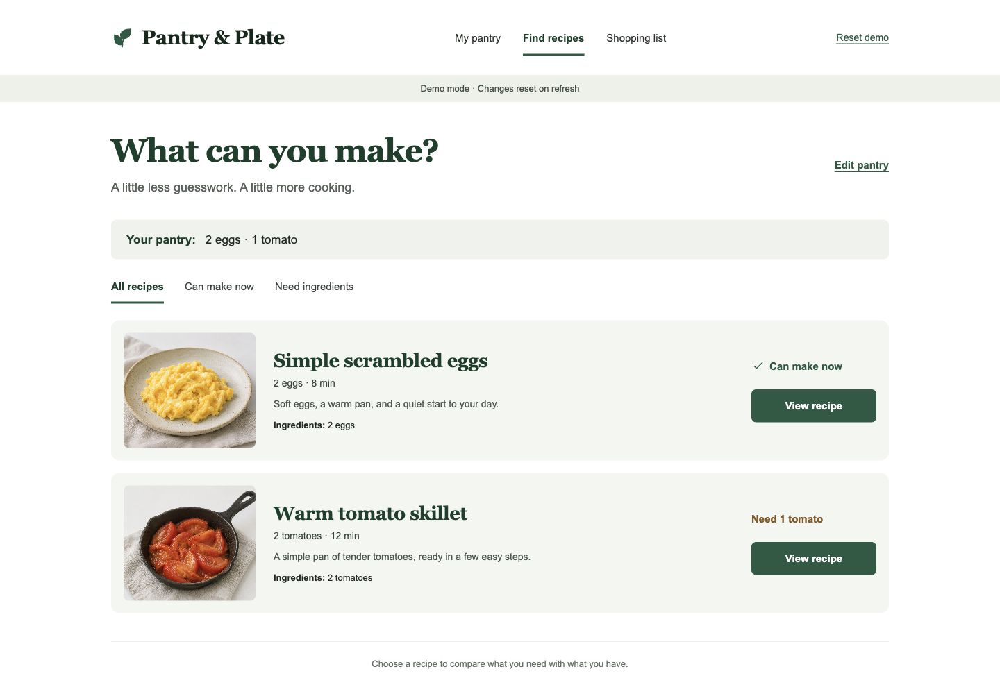
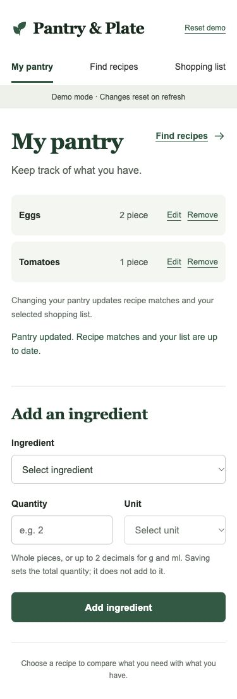
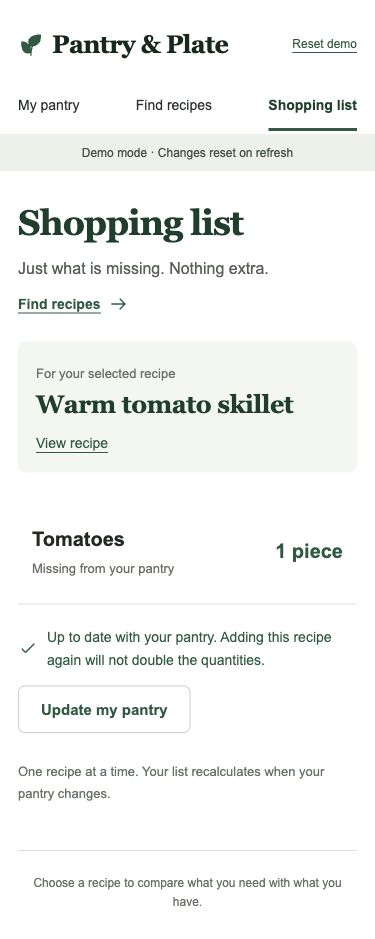

# Smart Recipe & Pantry Planner

**V1 开发版：** `feat/v1-core` 已实现本地持久化核心与 20 道带图菜谱。[运行手册](docs/V1-RUNBOOK.md) · [技术验收](docs/V1-ACCEPTANCE.md) · [开发计划](docs/V1-DEVELOPMENT-PLAN.zh-CN.md) · [菜谱来源](docs/RECIPE-CATALOG.md) · [发布状态](docs/V1-RELEASE.md)。尚待团队评审、独立成员复现和真实用户试用。

[English](README.md) | [简体中文](README.zh-CN.md)

一个帮助家庭烹饪者管理现有食材、发现菜谱、识别缺失食材并生成购物清单的软件项目。

**当前状态：V1 本机受控开发基线。** React/Vite 界面经 Express 读写 SQLite，刷新及重启保留库存和多菜清单。V2 仍为计划，多人共享运行另行验收。

**项目仓库：** [kekepepe/Smart-Recipe-Pantry-Planner](https://github.com/kekepepe/Smart-Recipe-Pantry-Planner)

## 界面预览

以下为实际运行的 V0 截图，使用“两蛋一番茄”示例，并非设计概念图。当前界面语言为英文。

### 桌面菜谱匹配



### 手机库存与购物清单

| 我的食材 | 购物清单 |
| --- | --- |
|  |  |

## 项目背景

许多人家中已有食材，却不知道可以做什么菜。浏览普通菜谱网站时，用户仍需手动核对库存，并逐项记录缺少的食材。本项目希望将食材管理、菜谱选择和采购准备连接起来，帮助用户节省时间、减少不必要的采购和食物浪费。

## 目标用户与利益相关者

| 利益相关者 | 主要需求 |
| --- | --- |
| 家庭烹饪者 | 根据家中已有食材找到合适的菜谱。 |
| 学生与忙碌上班族 | 减少选菜和准备购物清单所需的时间。 |
| 关注健康饮食的用户 | 查看热量估算，辅助日常饮食选择。 |
| 开发团队 | 需求明确、功能可测试、代码便于维护。 |
| 系统管理员 | 维护菜谱记录与基本系统数据，并监控错误。 |

## V0 历史原型

- 两蛋一番茄示例入口，以及从空库存自己添加。
- 食材与数量的新增、编辑、删除。
- 两道样例菜谱、需要／已有／缺少对照、动态匹配及单位不兼容提示。
- 不重复累加、随库存更新、不扣库存的单道菜购物清单。
- 手机浏览器布局、键盘操作和确认对话框；刷新会重置会话。

[技术与搭建计划](docs/V0-IMPLEMENTATION-PLAN.zh-CN.md) · [设计与素材记录](docs/design/V0-DESIGN.md)

## 版本功能

### V1 — 本地核心 MVP 已实现于开发分支

- **食材库存管理：** 添加、编辑和删除食材，并记录数量。
- **菜谱浏览：** 查看菜谱、所需食材和基本烹饪步骤。
- **基于库存的菜谱匹配：** 将菜谱区分为“现有食材可直接制作”和“购买缺失食材后可制作”。
- **购物清单：** 持久保存多道菜，显示逐菜缺口与合并采购量；共享食材需求先相加，再扣一次库存。可单独移除或确认清空。[实现与迁移说明](docs/V1-MULTI-RECIPE.md)。

核心使用流程：**录入库存食材 → 浏览匹配菜谱 → 查看缺失食材 → 生成购物清单**。

### V2 — 增强应用

- **每日菜谱推荐：** 提供独立于当前库存的每日推荐。
- **热量估算：** 根据菜谱食材展示整道菜和每份的热量估算。
- **购物清单优化：** 多菜合并已按追加需求提前完成于 V1；V2 继续考虑已购状态与后续便利性改进。
- **根据反馈改进：** 根据 V1 用户评价优化匹配结果、筛选和易用性。
- **可选功能，视时间而定：** 食材临期提醒。

### 不包含的范围

- 自行训练专用 AI 模型。
- 在线下单、支付或配送管理。
- 专业医学营养建议。

应用只生成待购食材清单，不处理实际购买流程。热量数据为日常参考用的估算值。

## 开发方法与路线图

项目采用**迭代增量开发（Iterative-Incremental Development）**。先通过 V1 完成核心使用流程，再通过用户评价确定 V2 的改进和增强功能。两个版本都应能够独立使用和演示。

| 阶段 | 计划工作 | 预期交付物 |
| --- | --- | --- |
| V0 准备与第 1 天评估 | 先准备本地原型，再于正式第 1 天检查可复用代码、需求及候选技术栈。 | 可运行原型、技术检查和按优先级排列的需求清单。 |
| 迭代 1 — V1 | 实现食材管理、菜谱浏览与匹配、缺失食材清单。 | 可运行的 MVP 与核心测试用例。 |
| 用户测试与评价 | 邀请样本用户完成典型任务，记录缺陷和反馈。 | 评价总结与调整后的 V2 需求清单。 |
| 迭代 2 — V2 | 改进 V1，增加每日推荐、热量估算和购物清单优化。 | 增强应用、回归测试与演示。 |

V0 已合入 main。本分支在其基础上完成 V1 本地核心开发；原两轮五工作日计划保留为团队安排，技术实现不能代替独立复现和真实评价。

## 版本验收目标

以下为产品验收目标；本轮已执行的技术结果见 V1-ACCEPTANCE，未执行的用户评价与发布门槛单独列出。

**V1**

- 用户可以保存食材及数量，并修改或删除库存记录。
- 用户可以查看菜谱所需食材和制作步骤。
- 用户可以区分现在能做的菜谱和需要补充食材的菜谱。
- 用户可以获得缺失食材的购物清单。

**V2**

- 用户可以获得不依赖当前库存的每日菜谱推荐。
- 用户可以查看整道菜及每份的热量估算。
- 用户可以合并多道菜的待购食材，并标记已购买的项目。
- 增强功能加入后，V1 的核心流程仍能正常使用。

## 开始使用

使用 `.nvmrc` 中的 Node.js 22.23.1：

```bash
git clone --branch feat/v1-core https://github.com/kekepepe/Smart-Recipe-Pantry-Planner.git
cd Smart-Recipe-Pantry-Planner
npm ci
npm run db:init
npm run dev
```

开发页为 [127.0.0.1:5173](http://127.0.0.1:5173/)。构建后 `npm start` 提供 [同源 V1 服务](http://127.0.0.1:3001/)；`npm run preview` 仅为静态预览，不能代替 V1 服务。

```bash
npx playwright install chromium
npm run check:v1
```

[运行手册](docs/V1-RUNBOOK.md) 包含配置、迁移、失败恢复与备份。数据库留在本机，不上传 GitHub。以上命令选择开发分支，main 合并/发布状态以 [发布记录](docs/V1-RELEASE.md) 为准。

## 规划依据

本 README 根据以下已提供的规划文档编写：

- `Smart_Recipe_and_Pantry_Planner_Project_Planning_Revised_task2.docx`：英文规划文档。
- `Smart_Recipe_and_Pantry_Planner_Project_Planning_CN_Revised_task2.docx`：中文规划文档。

文档涵盖利益相关者、版本范围、问题陈述、开发方法与成功标准。原始文件单独保留，未因编写 README 而修改。
