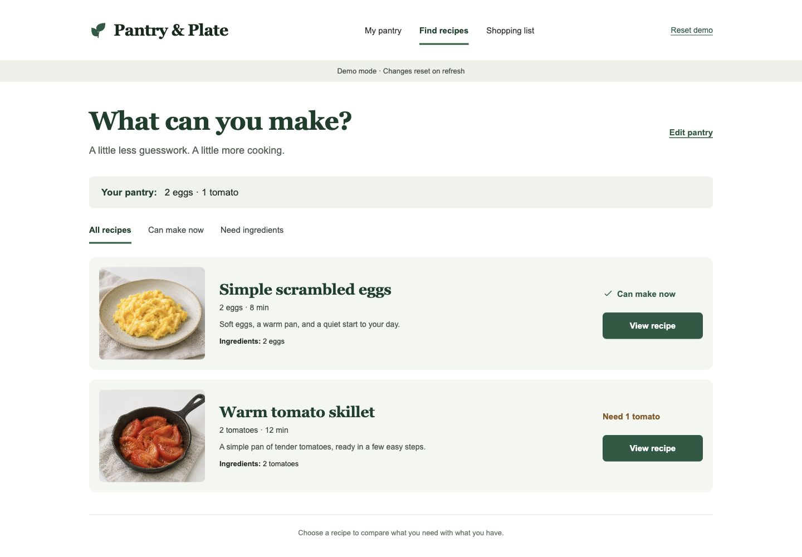
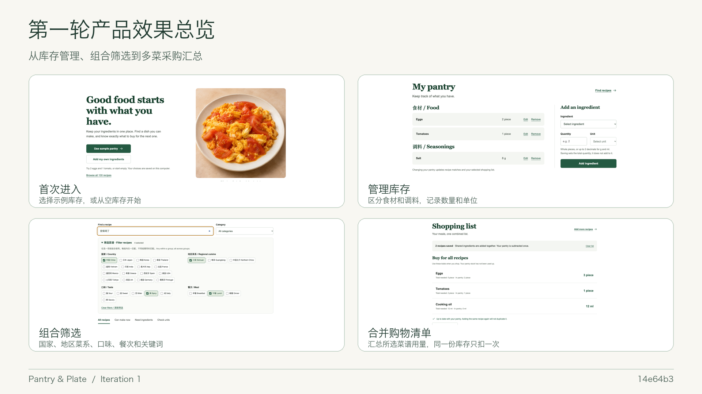
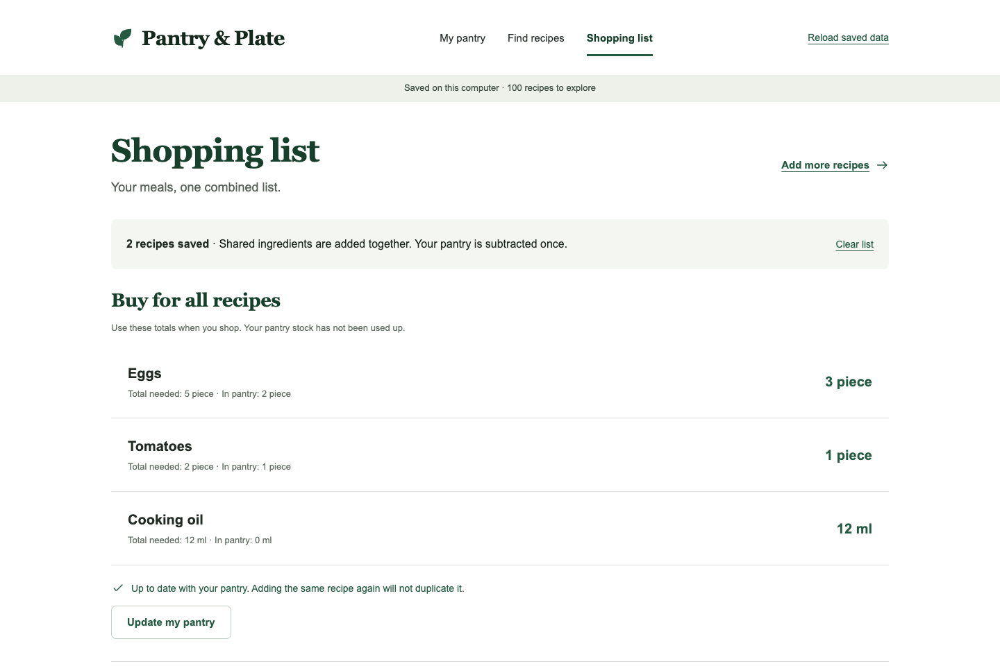
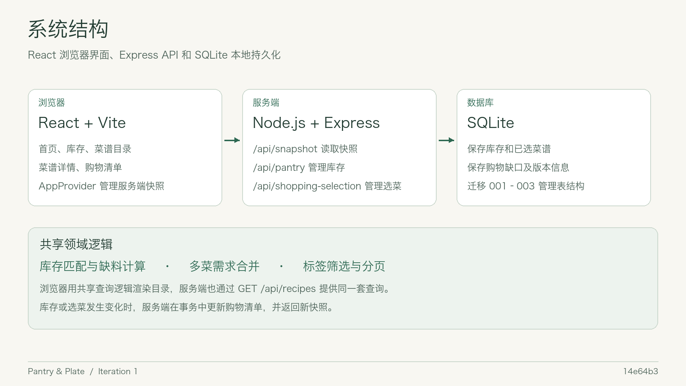
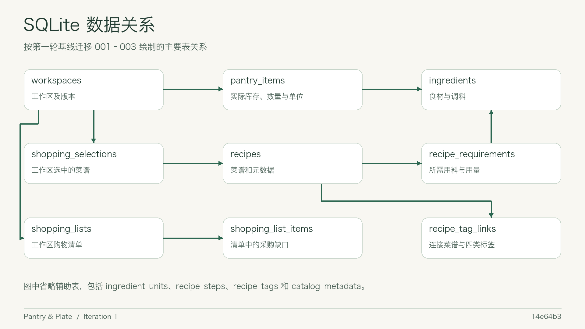
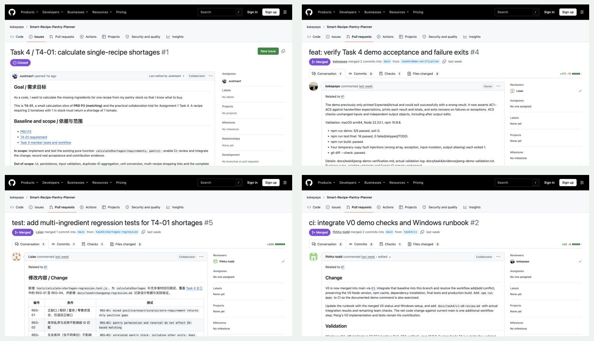
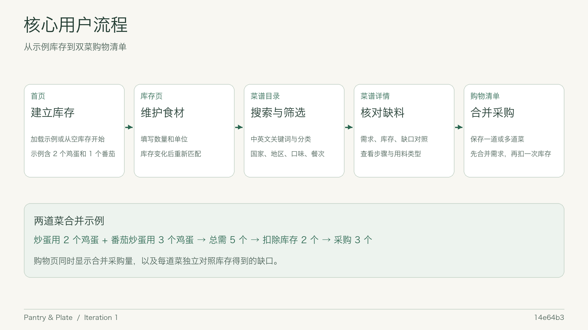

# Smart Recipe and Pantry Planner

**第一轮项目总结完整版**

从项目立项、课程任务和协作试跑，到第一轮应用交付与证据收尾。用于小组汇报、贡献追溯，以及第二轮前后对比。

第一轮应用基线已合入 main，库存、匹配、购物清单及 100 道菜谱的检索可以运行。质量测量已有记录并通过评审，但归档 PR 仍开放。正式第一轮材料还需补齐真实试用、四人复盘及证据 PR。

证据截点  2026-11-24 00:27 北京时间  ·  应用基线  14e64b3

> **截点后更新说明（2026-11-24）**：本文件完整保留 `2026-11-24 00:27` 历史快照（含当时 `#17` 尚待作者合并的记录）。截点后的第一轮收尾进展（`#17` 已合入 `a188c39` 并关闭 `#16`、`#18`/`#19` 已合入、`#20`/`#21` 缺陷建单、`#12` 外部样本 0 人缺口如实登记，以及 `#13` 最终流程度量基线与复盘）统一记录在 [第一轮成果评审、复盘、流程度量基线与证据索引](iteration-1-evidence-and-retrospective.md)。

[GitHub 项目](https://github.com/kekepepe/Smart-Recipe-Pantry-Planner)  ·  [第一轮总单 \#9](https://github.com/kekepepe/Smart-Recipe-Pantry-Planner/issues/9)  ·  [应用基线](https://github.com/kekepepe/Smart-Recipe-Pantry-Planner/commit/14e64b361ac95dc1772b9b25a34cffae49d140cd)

### 目录

| [01 项目启动与开发方法](#scope) | [09 Assignment 2 任务对应](#assessment) |
| --- | --- |
| [02 计划与需求验收](#plan) | [10 两轮对比基线](#comparison) |
| [03 协作试跑与 V0](#trial) | [11 GitHub 协作截图](#evidencevisual) |
| [04 从 V1 到第一轮基线](#evolution) | [附录 A 全部拉取请求](#pr) |
| [05 第一轮产品效果](#visual) | [附录 B 全部 Issue](#issue) |
| [06 系统结构与运行](#architecture) | [附录 C 全部提交](#commit) |
| [06.1 实现决策与验收示例](#implementation) | [附录 D 全部可见 CI 运行](#ci) |
| [07 四人贡献与交接](#team) | [附录 E 主要来源与复核入口](#sources) |
| [08 第一轮验证与收尾](#quality) |  |

## 01 项目启动与开发方法

[返回目录](#toc)

项目面向家庭做饭者，尤其是学生和忙碌的上班族，解决一个具体决策：根据现有食材判断今天能做什么，并计算下一道菜需要补买什么。早期报告提出减少手工对比、重复采购和食物浪费，第一轮的证据直接覆盖决策流程与计算正确性。

### Assignment 1 Task 1  项目定义

| **对象或问题** | **项目决定** |
| --- | --- |
| 核心用户 | 家庭做饭者管理库存、查菜谱、核对缺口；有营养需求的用户是后续热量估算的受众。 |
| 工程角色 | 开发者维护可测试需求和规则；运行维护者管理本地服务、目录种子、备份与恢复。 |
| 主要风险 | 新增范围挤占核心功能；并行修改导致接口冲突；原料标识与单位不一致产生错误可做判断。 |
| 范围和约束 | 四人小组、两个计划迭代、本地演示。购物指采购清单，支付、外卖和医疗营养建议超出项目范围。 |

### Assignment 1 Task 2  方法比较与选择

| **方法** | **适用情况** | **本项目中的取舍** |
| --- | --- | --- |
| 计划驱动 | 先明确范围、依赖和审批点。 | 数据库迁移和验收适合明确门槛，界面与筛选仍需根据实际观察调整。 |
| 迭代增量 | 先交付一条完整主流程，再扩增量。 | 采用。先让库存、匹配、清单可运行，再添加多菜、目录与复测；要求稳定数据契约。 |
| 轻量敏捷实践 | 频繁同步、评审与调整优先级。 | 用于迭代中的 Issue、PR 和复盘；其效果取决于真实用户和团队协调证据。 |

第一轮已经显示分阶段集成的价值：Windows 测试问题被定位到具体提交和修复 PR，修复后再确认 V2 基线。用户反馈对排期的影响须由实际试用与第二轮复测检验。

[Task 2 与 Task 3 文档提交](https://github.com/kekepepe/Smart-Recipe-Pantry-Planner/commit/4dbbc5b995c797dd59645a61650f5c3393b5e32d)  ·  [双语 PRD](https://github.com/kekepepe/Smart-Recipe-Pantry-Planner/blob/14e64b361ac95dc1772b9b25a34cffae49d140cd/docs/PRD.zh-CN.md)  ·  [方法证据与课程来源](#sources)

## 02 计划与需求验收

[返回目录](#toc)

Task 3 把项目划分为两段可演示增量，并为优先级、责任分工、验收和交接制定计划。原计划把 V0 作为原型准备，并用两个各五个工作日的迭代推进。第一段先跑通库存到清单，第二段根据反馈和产能安排增强。下表沿用 Assignment 1 的八项优先级，列出第一轮已查到的结果。

| **优先级** | **需求与验收标准** | **截至截点的结果** |
| --- | --- | --- |
| Must 1 库存 | 录入、修改、删除；拒绝负数；刷新和重启保留。 | 技术验收已记录于 \#11。 |
| Must 2 浏览 | 空库存可浏览；详情含用量、单位和步骤；返回保留状态。 | 技术验收已记录于 \#11；目录扩到 100 道。 |
| Must 3 匹配 | 现有量足够才显示可做；缺料列出数量；单位冲突显式提示。 | 技术验收已记录于 \#11；规则由 ChangPeng 复核。 |
| Must 4 单菜清单 | 只列当前缺口；重复添加幂等；足够时无须采购；保留选择。 | 技术验收已记录于 \#11；购物不扣减库存。 |
| Should 5 多菜 | 汇总需求后库存只扣一次；已购标记可持久化。 | 多菜提前进入 V1；已购持久化待实现。 |
| Should 6 每日灵感 | 空库存也可展示；灵感与库存可做性分开。 | 待纳入后续增量。 |
| Should 7 热量 | 总热量与每份计算可验证；列来源，缺失明确。 | 待纳入后续增量。 |
| Should 8 反馈闭环 | 实际试用发现问题，修复后同任务复测。 | 现有 Issue \#12 记录 0 位参与者；尚未形成闭环。 |

### 计划与交付的差异

最初计划按 Must 与 Should 分层。多菜清单提前并入 V1。V2 先做食材和调料分类、目录、检索及迁移。主食材推荐、每日灵感、已购持久化及热量仍需后续选定；配方倍数为可选，公网与多账号仍在后续范围。

[需求优先级](https://github.com/kekepepe/Smart-Recipe-Pantry-Planner/blob/14e64b361ac95dc1772b9b25a34cffae49d140cd/docs/PRD.zh-CN.md)  ·  [Issue \#10](https://github.com/kekepepe/Smart-Recipe-Pantry-Planner/issues/10)  ·  [Issue \#11](https://github.com/kekepepe/Smart-Recipe-Pantry-Planner/issues/11)  ·  [两轮分工](https://github.com/kekepepe/Smart-Recipe-Pantry-Planner/blob/14e64b361ac95dc1772b9b25a34cffae49d140cd/docs/V2-REMAINING-WORK-ASSIGNMENT.zh-CN.md)

## 03 协作试跑与 V0

[返回目录](#toc)

Task 4 选取一个可独立验收的协作切片 T4-01。规则接受规范原料和有效数量，用库存计算单菜缺料；缺少库存按零计，只返回正缺口并维持菜谱顺序，计算过程不改变输入。该任务的验收范围集中在缺料函数。

| **环节** | **成员** | **产出与证据** |
| --- | --- | --- |
| 开需求与验收 | Mao | 创建 \#1，记录 T4-01、预期与关闭说明。 |
| 实现与界面原型 | Peng | PR \#3 集成 V0 库存、浏览、匹配、清单与初始测试。V0 刷新重置。 |
| 集成与 Windows | Hao | PR \#2 增加 CI 检查和运行说明，解决工作流集成问题。Peng 审批。 |
| Demo 可自动判定 | Peng | PR \#4 将预期输出变成断言。5/5 通过；四次故障注入均返回非零退出。ChangPeng 审批。 |
| 边界回归 | ChangPeng | PR \#5 增加五项回归，覆盖已足、缺料及未入库混合、保持顺序、无关食材和对象独立性。Hao 审批。 |

### 试跑的可复核结论

任务链以 main 的 c36b655 收束，集成 CI 通过。Issue \#1 的关闭留言称独立复现、验收与复盘已记录，归档证据文件的相关栏仍待完成。两条记录存在差异，第一轮的 \#11 独立复现属于后续应用基线。

[Issue \#1](https://github.com/kekepepe/Smart-Recipe-Pantry-Planner/issues/1)  ·  [PR \#3](https://github.com/kekepepe/Smart-Recipe-Pantry-Planner/pull/3)  ·  [PR \#2](https://github.com/kekepepe/Smart-Recipe-Pantry-Planner/pull/2)  ·  [PR \#4](https://github.com/kekepepe/Smart-Recipe-Pantry-Planner/pull/4)  ·  [PR \#5](https://github.com/kekepepe/Smart-Recipe-Pantry-Planner/pull/5)  ·  [42182136651](https://github.com/kekepepe/Smart-Recipe-Pantry-Planner/actions/runs/42182136651)  ·  [Task 4 归档](https://github.com/kekepepe/Smart-Recipe-Pantry-Planner/blob/14e64b361ac95dc1772b9b25a34cffae49d140cd/docs/task4/evidence.md)

图 1  V0 菜谱页的项目留档截图。

## 04 从 V1 到第一轮基线

[返回目录](#toc)

| **阶段** | **代码与交付** | **边界** |
| --- | --- | --- |
| 项目启动 11-04 至 11-06 | 双语 README、Task 2 方法比较、Task 3 计划、PRD 与角色。 | 构建需求和实施依据。 |
| V0 11-06 | 库存、浏览、匹配和清单原型；Task 4 用 demo 与 CI 验证单菜缺口。 | 原型刷新会重置。 |
| V1 11-06 至 11-07 | React + Express + SQLite 持久化；20 道带图菜谱；增加多菜清单、自动检查、数据库备份与恢复。 | 两条 Windows 相关修订涉及驱动安装与重启测试清理。 |
| V2 首批 11-21 | 保留原 20 道并新增 80 道；提供中英文检索、分类、多维筛选、URL 条件、稳定分页和查询 API；新增数据库迁移 003。 | 主食材推荐、每日灵感、已购持久化、热量及用户反馈闭环待做。 |
| 第一轮集成 11-23 | PR \#7、\#8 进 main，Windows 修复 \#15 先进入 V2 分支，再随 \#8 进入 main。基线 14e64b3 完成独立复现。 | 测量证据提交 3167f9d 单列，应用测试使用 14e64b3。 |

### V2 目录与匹配规则

当前目录含 286 种规范原料，按食材 174 种、调料 112 种分类。必需调料仍参与库存匹配与采购计算。筛选在同一维度内取任一结果，不同维度同时满足；关键词支持中英文菜名和已有双语名称的原料。每页 20 道，总计 5 页。

原目录保留两道演示菜和 18 道 HowToCook 改编。新增 80 道来自固定版本的 UniTools 数据，其改编数据沿用 CC BY-SA 4.0。当前 100 张菜图是生成示意图，应用保留菜谱数据出处与改编记录。

[PR \#7](https://github.com/kekepepe/Smart-Recipe-Pantry-Planner/pull/7)  ·  [PR \#8](https://github.com/kekepepe/Smart-Recipe-Pantry-Planner/pull/8)  ·  [PR \#15](https://github.com/kekepepe/Smart-Recipe-Pantry-Planner/pull/15)  ·  [14e64b3](https://github.com/kekepepe/Smart-Recipe-Pantry-Planner/commit/14e64b361ac95dc1772b9b25a34cffae49d140cd)  ·  [目录与来源](https://github.com/kekepepe/Smart-Recipe-Pantry-Planner/blob/14e64b361ac95dc1772b9b25a34cffae49d140cd/docs/RECIPE-CATALOG.md)  ·  [V2 交付说明](https://github.com/kekepepe/Smart-Recipe-Pantry-Planner/blob/14e64b361ac95dc1772b9b25a34cffae49d140cd/docs/V2-DISCOVERY.md)

## 05 第一轮产品效果

[返回目录](#toc)

下列画面来自第一轮应用基线。演示从两个鸡蛋和一个番茄开始，补录调料以展示分组。搜索“宫保鸡丁”可以与国家、菜系、口味、餐次叠加。

图 2  第一轮产品效果。首页、库存、组合筛选和多菜采购。

图 3  两道菜合并采购。鸡蛋总需 5 个，库存 2 个，采购 3 个。

[系统结构](#architecture)  ·  [核心需求与实际结果](#plan)

## 06 系统结构与运行

[返回目录](#toc)

浏览器从 API 获取库存和目录快照，服务端持久化库存与选菜。前端目录和 GET /api/recipes 共享筛选模块。库存或菜谱选择变化时，服务端在事务中更新合并缺口，并返回更新后的快照。

图 4  浏览器、API、共享规则与 SQLite。

图 5  第一轮数据库主要表关系与迁移范围。

本地复现入口使用 Node.js 22。执行 npm ci、npm run db:init、npm run build，再运行 npm start。已有库存的迁移和恢复按运行手册操作。

[README 安装与运行](https://github.com/kekepepe/Smart-Recipe-Pantry-Planner/blob/14e64b361ac95dc1772b9b25a34cffae49d140cd/README.zh-CN.md)  ·  [V1 运行手册](https://github.com/kekepepe/Smart-Recipe-Pantry-Planner/blob/14e64b361ac95dc1772b9b25a34cffae49d140cd/docs/V1-RUNBOOK.md)  ·  [共享筛选模块](https://github.com/kekepepe/Smart-Recipe-Pantry-Planner/blob/14e64b361ac95dc1772b9b25a34cffae49d140cd/src/discover-recipes.js)

## 06.1 实现决策与验收示例

[返回目录](#toc)

规范原料 ID、单位和持久化状态贯穿库存、菜谱和采购清单。每个关键决定都配有可复核的验收路径。

| **实现决定** | **行为与验收** |
| --- | --- |
| 区分原料类别与配方角色 | 库存以 ingredients.kind 分组，配方每行用 recipe\_requirements.role 标示角色。调料仍参与可做性和采购计算。 |
| 明确单位边界 | 数量及单位参与匹配。单位不兼容时显示 Check units，并提示核对库存。人工验收可切换同一原料的单位查看提示。 |
| 汇总需求后扣一次库存 | 手算夹具的两道菜各需 2 个番茄，库存 1 个，合并清单应为 3 个。图 3 的实际双菜示例用鸡蛋验证相同规则。重复加入同一菜谱保持幂等。 |
| 维护检索状态 | 中英文关键词和标签可以组合。切换筛选后回到结果第一页，详情返回和刷新保留 URL 条件。有效零结果、无效筛选分别有提示。 |
| 升级并保留数据 | 迁移 003 增加类别、配方角色与标签关联。旧库升级先备份，再迁移并显式更新种子。夹具核对已有库存、选菜顺序及派生采购缺口。 |

### 演示与复测入口

用样例库存依次走一遍空库存浏览、组合筛选、单菜缺口、双菜汇总与重启验证。想复现试用卡点时应同时记录应用 SHA、浏览器、任务完成情况和参与者的原始观察。

[多菜规则](https://github.com/kekepepe/Smart-Recipe-Pantry-Planner/blob/14e64b361ac95dc1772b9b25a34cffae49d140cd/docs/V1-MULTI-RECIPE.md)  ·  [V2 迁移说明](https://github.com/kekepepe/Smart-Recipe-Pantry-Planner/blob/14e64b361ac95dc1772b9b25a34cffae49d140cd/docs/V2-DISCOVERY.md)  ·  [Issue \#11](https://github.com/kekepepe/Smart-Recipe-Pantry-Planner/issues/11)  ·  [Issue \#12](https://github.com/kekepepe/Smart-Recipe-Pantry-Planner/issues/12)

## 07 四人贡献与交接

[返回目录](#toc)

贡献归属使用实际 PR 作者、评审者、合并者和 Issue 日志。计划主责帮助解释职责，实际提交和验收决定完成归属。Git 中显示为 Mavis 的部分提交由特定 PR 与账号记录关联，提交附录保留原始作者显示名。

| **成员** | **Assignment 1 的可核对贡献** | **第一轮的可核对贡献** |
| --- | --- | --- |
| Peng Ke @kekepepe | V0 原型与初版测试（\#3）；demo 断言和故障验证（\#4）；审批 Hao 的 CI（\#2）。早期 README、计划和 PRD 有相应提交。 | 发起 \#6；V1 和 V2 首批作者，PR \#7 / \#8 经 Hao 与 ChangPeng 审批后本人合并；复核 \#15 集成，登记共享基线。 |
| ChangPeng Shi @Lsiav | 审批 \#4；在 \#5 添加五个回归测试，经 Hao 审批并自行合并。 | 审批 \#7 的匹配/多菜规则、\#8 的检索与回归、\#15 的 Windows 修复及 \#17 的测量。\#8 留有 26/26 筛选夹具复核。 |
| HaoZhe Feng @fhhhz-todd | 在 \#2 集成 CI 和 Windows 运行说明，经 Peng 审批并自行合并；审批 \#5。 | 审批 \#7 / \#8；创建并修复 \#14，经 ChangPeng 审批后合并 \#15；创建 \#16、执行实测并发 \#17，合并待办。 |
| ZheKai Mao @Justmao1 | 创建并跟踪 \#1；计划主责为需求、验收与试用。Task 4 关单说明与证据文件存在差异。 | 创建 \#9–\#13；确认四项 Must 与目录来源，复核 \#8；执行业务及干净目录验收 \#11；复核 \#17 测量口径。试用及复盘待办。 |

### 交接做法

非作者负责审批或留下具体复核，作者本人负责合并。发生实质更新后需回到实际 head 确认 CI 和评审。PR \#8 在 11 月 23 日 09:15 把目标从 V1 分支调整至 main，09:17 转为 Ready。将 main 合入 PR 分支后，以 ea87203 作为评审 head，三平台 CI 通过。最终合并树与评审版本一致。

[全部 PR](#pr)  ·  [全部 Issue](#issue)  ·  [全部提交](#commit)

## 08 第一轮验证与收尾

[返回目录](#toc)

### 功能与可复现性

Mao 在 macOS arm64、Node 22.23.5、Chromium 的干净目录检出 14e64b3。记录为 67/67 项测试通过，另有 demo 5/5 断言，生产构建通过。用真实 Express 和 SQLite 检查库存增删改、浏览/返回、单位不匹配、单菜和合并清单，并验证重启持久化及备份恢复。记录中新增核心阻塞缺陷为 0。

[Issue \#11](https://github.com/kekepepe/Smart-Recipe-Pantry-Planner/issues/11)  ·  [独立复现原始日志](https://github.com/kekepepe/Smart-Recipe-Pantry-Planner/issues/11#issuecomment-7090522128)  ·  [45102412397](https://github.com/kekepepe/Smart-Recipe-Pantry-Planner/actions/runs/45102412397)

### 质量场景实测

Hao 在 Windows x64、Node 22.23.1，对固定基线的 GET /api/recipes 做本机 HTTP 测量。使用 100 道菜、样例库存、两道已选菜；每场景每轮预热 10 次并测量 50 次，共三轮四场景，单并发。四场景是无筛选首页、五条件组合、空结果和尾页。600/600 个响应正确，五条件组合查询中位 14.912 ms，最近秩法 p95 为 17.549 ms。测的是本机热缓存请求，协议未设数值 SLA。

ChangPeng 在 3167f9d 审批，Mao 复核统计口径，三平台 CI 绿。\#17 尚开放，数据文件、脚本和报告在 PR 里可核对；合入后由 Hao 把证据回链 \#9、\#13，再收 \#16。

[Issue \#16](https://github.com/kekepepe/Smart-Recipe-Pantry-Planner/issues/16)  ·  [PR \#17](https://github.com/kekepepe/Smart-Recipe-Pantry-Planner/pull/17)  ·  [45164542636](https://github.com/kekepepe/Smart-Recipe-Pantry-Planner/actions/runs/45164542636)

### 第一轮正式收尾

| **工作项** | **证据状态及完成条件** |
| --- | --- |
| 真实用户试用 \#12 | 目标 5 位，当前登记 0 位。试用以同一库存和任务开始，记录实际完成人数、卡点与限制，观察到的问题另开单。 |
| 独立复现 \#11 | 已记录结果；由 Hao 在第一轮证据 PR 内核验，随其归档。 |
| 复盘与流程度量 \#13 | 组织四人回顾，记录流程问题及措施，提交证据 PR；Hao 审批后由 Mao 合并，随后发第二轮总单。 |
| 适用边界 | 已有覆盖是 Chromium 与三平台 CI；Safari、Firefox、手机真机和托管多用户未纳入独立复现。浏览器 CI 跑过，产物上传路径有待同步。 |

[Issue \#12](https://github.com/kekepepe/Smart-Recipe-Pantry-Planner/issues/12)  ·  [Issue \#13](https://github.com/kekepepe/Smart-Recipe-Pantry-Planner/issues/13)  ·  [Issue \#9](https://github.com/kekepepe/Smart-Recipe-Pantry-Planner/issues/9)  ·  [PR \#8](https://github.com/kekepepe/Smart-Recipe-Pantry-Planner/pull/8)

## 09 Assignment 2 任务对应

[返回目录](#toc)

Assignment 2 要求同一团队持续迭代，并用两轮证据评价开发过程。第一轮已经建立可运行基线和测量入口。下表按课程的五个任务登记手头结果与后续交付。

| **课程任务** | **第一轮已取得的证据** | **后续需要提供** |
| --- | --- | --- |
| 1 两轮协作开发 | Issue \#9 记录范围、角色、验收和基线。\#7、\#8、\#15 留下评审、合并和 CI。 | 完成第一轮 Review 与复盘；启动第二轮追踪，并记录增量、结果、变更理由和第二轮复盘。 |
| 2 测试与质量评价 | 四项 Must 技术验收、独立复现、API/集成/浏览器检查，以及查询性能实测。 | 归档 \#17；在被选范围复测，记录版本、环境、数据、步骤、结果和限制。 |
| 3 实施并评价流程改进 | \#9 已定义 24 小时证据完整率、评审与 CI 返工、干净目录、试用完成率。 | 由复盘选择有证据的问题与措施，第二轮实施。以相同规则记录样本和差异。 |
| 4 批判性评价方法与工具 | A1 比较计划驱动、迭代增量和敏捷实践；第一轮得到独立验收、PR 迭代和 CI 实例。 | 回顾至少两种方法并结合研究；说明选定做法的收益、负担及替代方案。 |
| 5 实物演示与个人贡献 | 可演示库存→筛选→详情→多菜清单；已有按人追溯的 PR、Issue、评审、测试截图与记录。 | 按课程安排做小组演示和问答；四人分别提交个人贡献、决策、结果与证据链接。 |

### 最终可交付物

课程简报要求小组 PDF、可访问仓库与固定提交或 release、证据索引和演示。当前文档是用于第一轮归档和第二轮对照的工作材料。将最终对照数据、学术来源和个人声明纳入课程交付时，可从本册对应章节提取。

[课程简报](https://canvas.aut.ac.nz/courses/23715/assignments/197930)  ·  [团队贡献](#team)  ·  [第一轮原始验证](#quality)

## 10 两轮对比基线

[返回目录](#toc)

第二轮应保留应用 SHA、测量脚本和原始记录。下列第一轮值用于未来对比，未完成的统计保留待核状态。第一轮归档时再把最终样本、复盘选择和证据链接补进同一口径。

| **维度** | **第一轮观测** | **第二轮记录字段及计算** |
| --- | --- | --- |
| 24 小时证据完整率 | 已合并样本暂见 \#7、\#8、\#15。截点时三项均未到合并后 24 小时，分子、最终样本和正式比率待冻结。 | 记录完整数/合并数及样本明细。匹配 Issue、范围、测试命令与结果、被测 SHA、审批与 CI、合并人及 SHA。差值用百分点。 |
| 评审及 CI 返工 | 已查第一轮 PR 无正式 Request changes。\#8 两次 PR CI 失败均早于 09:17 转 Ready；可见记录无该 PR 转 Ready 后失败，整体统计待复盘冻结。 | 逐 PR 记录 Request changes 和 Ready 后失败重跑；保留每次运行 ID，避免把推送与 PR 重复记为同一失败。 |
| 干净目录复现 | 技术复现通过，1 次有结果；首次启动前有 Node 版本切换；新增阻塞缺陷 0。 | 用相同任务链复现，登记首次结果、环境调整、阻塞缺陷及证据。 |
| 真实用户任务完成率 | 0 位已登记，完成率未定义。 | 分子为无提示完成数，分母为实到人数。保留同一任务、基线/候选版本、卡点及复测结果。 |
| 五条件查询延迟 | 中位 14.912 ms、p95 17.549 ms；600/600 响应正确（四场景合计）。 | 同机、同 Node、目录、场景和并发优先；列正确率、绝对差与相对变化，注明条件差异。 |
| 范围与用户体验 | 100 菜、组合筛选、多菜清单可用；已购与 E4 待做。 | 登记交付项、验收证据、延期理由，以及从第一轮卡点到修复与同任务复测的链接。 |

### 复盘需作出的决定

候选干预是把证据登记放进合并交接，用 \#9 的六项口径复核。课程要求先用第一轮证据确认流程问题，再在第二轮采用选定措施并测量效果。第一轮截图目前可以作为演示素材，流程改进结论须等两轮数据。

[Issue \#9](https://github.com/kekepepe/Smart-Recipe-Pantry-Planner/issues/9)  ·  [Issue \#13](https://github.com/kekepepe/Smart-Recipe-Pantry-Planner/issues/13)  ·  [PR \#17](https://github.com/kekepepe/Smart-Recipe-Pantry-Planner/pull/17)  ·  [Assignment 2 课程要求](https://canvas.aut.ac.nz/courses/23715/assignments/197930)

## 11 GitHub 协作截图

[返回目录](#toc)

以下为 Assignment 1 归档中的四张 GitHub 页面截图，显示需求建单、demo、回归和 CI 集成。合并人及批准情况另以链接的 GitHub 记录为准。

图 6  从左至右、从上至下为 \#1 需求、\#4 demo、\#5 回归及 \#2 CI。

[Issue \#1](https://github.com/kekepepe/Smart-Recipe-Pantry-Planner/issues/1)  ·  [PR \#4](https://github.com/kekepepe/Smart-Recipe-Pantry-Planner/pull/4)  ·  [PR \#5](https://github.com/kekepepe/Smart-Recipe-Pantry-Planner/pull/5)  ·  [PR \#2](https://github.com/kekepepe/Smart-Recipe-Pantry-Planner/pull/2)  ·  [42182136651](https://github.com/kekepepe/Smart-Recipe-Pantry-Planner/actions/runs/42182136651)

### 第一轮集成和测量链

从 \#6 进入交接。\#7 先合入 V1，\#15 修复 Windows 后合入 V2 分支，\#8 重跑检查并集成。\#11 与 \#16 分别保留独立复现和测量，\#13 汇集复盘和归档。

图 7  核心演示流程，从示例库存到合并清单。

[Issue \#6](https://github.com/kekepepe/Smart-Recipe-Pantry-Planner/issues/6)  ·  [PR \#7](https://github.com/kekepepe/Smart-Recipe-Pantry-Planner/pull/7)  ·  [PR \#15](https://github.com/kekepepe/Smart-Recipe-Pantry-Planner/pull/15)  ·  [PR \#8](https://github.com/kekepepe/Smart-Recipe-Pantry-Planner/pull/8)  ·  [Issue \#11](https://github.com/kekepepe/Smart-Recipe-Pantry-Planner/issues/11)  ·  [Issue \#16](https://github.com/kekepepe/Smart-Recipe-Pantry-Planner/issues/16)  ·  [Issue \#13](https://github.com/kekepepe/Smart-Recipe-Pantry-Planner/issues/13)

## 附录 A 全部拉取请求

[返回目录](#toc)

共 8 个 PR，按编号追溯作者、评审结果、目标分支与合并。审批记录附链接；评审意见和 GitHub 检查历史也可从 PR 原页展开。时间均为北京时间。

| **PR** | **范围** | **作者与目标** | **审批与复核** | **合并人及提交** |
| --- | --- | --- | --- | --- |
| [PR \#2](https://github.com/kekepepe/Smart-Recipe-Pantry-Planner/pull/2) | Task 4 CI 与 Windows | fhhhz-todd → main | [kekepepe 批准](https://github.com/kekepepe/Smart-Recipe-Pantry-Planner/pull/2#pullrequestreview-5796639750) | fhhhz-todd 11-06 14:43  4946181 |
| [PR \#3](https://github.com/kekepepe/Smart-Recipe-Pantry-Planner/pull/3) | V0 原型 | kekepepe → main | 无单独评审记录 | kekepepe 11-06 14:23  f75ba58 |
| [PR \#4](https://github.com/kekepepe/Smart-Recipe-Pantry-Planner/pull/4) | Demo 断言与失败返回 | kekepepe → main | [Lsiav 批准](https://github.com/kekepepe/Smart-Recipe-Pantry-Planner/pull/4#pullrequestreview-5796759873) | kekepepe 11-06 14:54  9057ec5 |
| [PR \#5](https://github.com/kekepepe/Smart-Recipe-Pantry-Planner/pull/5) | 单菜回归 | Lsiav → main | [fhhhz-todd 批准](https://github.com/kekepepe/Smart-Recipe-Pantry-Planner/pull/5#pullrequestreview-5797090603) | Lsiav 11-06 15:37  c36b655 |
| [PR \#7](https://github.com/kekepepe/Smart-Recipe-Pantry-Planner/pull/7) | V1 持久化及多菜基线 | kekepepe → main | [fhhhz-todd 批准](https://github.com/kekepepe/Smart-Recipe-Pantry-Planner/pull/7#pullrequestreview-6015376304) · [Lsiav 批准](https://github.com/kekepepe/Smart-Recipe-Pantry-Planner/pull/7#pullrequestreview-6015384331) | kekepepe 11-23 08:41  f4559bb |
| [PR \#8](https://github.com/kekepepe/Smart-Recipe-Pantry-Planner/pull/8) | V2 首批目录、筛选与集成 | kekepepe → main | [fhhhz-todd 批准](https://github.com/kekepepe/Smart-Recipe-Pantry-Planner/pull/8#pullrequestreview-6015709039) · [Lsiav 批准](https://github.com/kekepepe/Smart-Recipe-Pantry-Planner/pull/8#pullrequestreview-6015811506) · [Justmao1 复核](https://github.com/kekepepe/Smart-Recipe-Pantry-Planner/pull/8#pullrequestreview-6015970642) | kekepepe 11-23 10:49  14e64b3 |
| [PR \#15](https://github.com/kekepepe/Smart-Recipe-Pantry-Planner/pull/15) | Windows SQLite 关闭顺序 | fhhhz-todd → feat/v2-discovery-handoff | [kekepepe 复核](https://github.com/kekepepe/Smart-Recipe-Pantry-Planner/pull/15#pullrequestreview-6015419426) · [Lsiav 批准](https://github.com/kekepepe/Smart-Recipe-Pantry-Planner/pull/15#pullrequestreview-6015521057) | fhhhz-todd 11-23 09:06  3f334f7 |
| [PR \#17](https://github.com/kekepepe/Smart-Recipe-Pantry-Planner/pull/17) | 第一轮查询时延记录 | fhhhz-todd → main | [Justmao1 复核](https://github.com/kekepepe/Smart-Recipe-Pantry-Planner/pull/17#pullrequestreview-6021327364) · [Lsiav 批准](https://github.com/kekepepe/Smart-Recipe-Pantry-Planner/pull/17#pullrequestreview-6022377512) | 开放；等待作者合并 |

PR \#3 在仓库记录中无单独审批。PR \#17 的应用被测 SHA 为 14e64b3，测量脚本与证据 SHA 为 3167f9d。

[GitHub 全部 PR](https://github.com/kekepepe/Smart-Recipe-Pantry-Planner/pulls)  ·  [CI 运行明细](#ci)

## 附录 B 全部 Issue

[返回目录](#toc)

| **Issue** | **创建者与负责人** | **时间与状态** | **工作及证据** | **留言** |
| --- | --- | --- | --- | --- |
| [Issue \#1](https://github.com/kekepepe/Smart-Recipe-Pantry-Planner/issues/1) | Justmao1 / Justmao1 | 创建 11-06 11:23 关闭 11-06 14:49 | 单菜缺口，链接 \#2–\#5；关闭说明与仓库证据文件有差异。 | [1](https://github.com/kekepepe/Smart-Recipe-Pantry-Planner/issues/1#issuecomment-6679027056) |
| [Issue \#6](https://github.com/kekepepe/Smart-Recipe-Pantry-Planner/issues/6) | kekepepe / kekepepe | 创建 11-21 15:46 开放 | 两条基线均已合入；已有共享 SHA 及 CI 回链；待交接收口。 | [1](https://github.com/kekepepe/Smart-Recipe-Pantry-Planner/issues/6#issuecomment-7090250979) |
| [Issue \#9](https://github.com/kekepepe/Smart-Recipe-Pantry-Planner/issues/9) | Justmao1 / Justmao1 | 创建 11-21 16:52 开放 | 第一轮范围、基线、角色、口径及成员确认；待归档。 | [1](https://github.com/kekepepe/Smart-Recipe-Pantry-Planner/issues/9#issuecomment-7088433157) · [2](https://github.com/kekepepe/Smart-Recipe-Pantry-Planner/issues/9#issuecomment-7088897237) · [3](https://github.com/kekepepe/Smart-Recipe-Pantry-Planner/issues/9#issuecomment-7090251529) · [4](https://github.com/kekepepe/Smart-Recipe-Pantry-Planner/issues/9#issuecomment-7099526253) |
| [Issue \#10](https://github.com/kekepepe/Smart-Recipe-Pantry-Planner/issues/10) | Justmao1 / Justmao1 | 创建 11-21 16:52 关闭 11-23 10:50 | 四个 Must、手算夹具及目录来源复核；\#8 合入后关闭。 | [1](https://github.com/kekepepe/Smart-Recipe-Pantry-Planner/issues/10#issuecomment-7090101710) |
| [Issue \#11](https://github.com/kekepepe/Smart-Recipe-Pantry-Planner/issues/11) | Justmao1 / Justmao1 | 创建 11-21 16:52 开放 | 独立复现通过并记录，等第一轮证据 PR。 | [1](https://github.com/kekepepe/Smart-Recipe-Pantry-Planner/issues/11#issuecomment-7090522128) |
| [Issue \#12](https://github.com/kekepepe/Smart-Recipe-Pantry-Planner/issues/12) | Justmao1 / Justmao1 | 创建 11-21 16:52 开放 | 真实试用与缺陷收集；登记参与者 0。 | — |
| [Issue \#13](https://github.com/kekepepe/Smart-Recipe-Pantry-Planner/issues/13) | Justmao1 / Justmao1 | 创建 11-21 16:52 开放 | 第一轮 Review、复盘、度量以及证据 PR，仍待交付。 | [1](https://github.com/kekepepe/Smart-Recipe-Pantry-Planner/issues/13#issuecomment-7099527036) |
| [Issue \#14](https://github.com/kekepepe/Smart-Recipe-Pantry-Planner/issues/14) | fhhhz-todd / fhhhz-todd | 创建 11-23 08:30 关闭 11-23 09:07 | Windows 文件锁定，\#15 合并后关闭。 | [1](https://github.com/kekepepe/Smart-Recipe-Pantry-Planner/issues/14#issuecomment-7088433464) · [2](https://github.com/kekepepe/Smart-Recipe-Pantry-Planner/issues/14#issuecomment-7088896996) |
| [Issue \#16](https://github.com/kekepepe/Smart-Recipe-Pantry-Planner/issues/16) | fhhhz-todd / fhhhz-todd | 创建 11-23 19:18 开放 | 固定应用基线质量场景，测量完成，待 \#17 合并并记录。 | [1](https://github.com/kekepepe/Smart-Recipe-Pantry-Planner/issues/16#issuecomment-7099527645) |

### Issue 与 PR 的关系

GitHub 时间线显示九个 Issue 均有指派动作。\#1、\#10 和 \#14 已关单，其余开放。表中留言编号可跳到原始留言，包含验收、合并或状态登记。

Task 4 由 \#1 串起实现、CI、demo 和回归。Assignment 2 由 \#6 交接主线基线，\#9 跟踪第一轮，\#10–\#13 记录验收、试用与归档，\#14 追踪 Windows 修复，\#16 记录质量实测。第一轮实体需求的代码、验证和关闭状态可分别沿链接核对。

[GitHub 全部 Issue](https://github.com/kekepepe/Smart-Recipe-Pantry-Planner/issues)  ·  [贡献分工与实际工作](#team)

## 附录 C 全部提交 上

[返回目录](#toc)

按 Git 拓扑顺序列出整理本报告前 9 个远程分支可达的 30 个唯一提交，包含 PR 合并节点和开放测量分支。第 1–15 条。日期为作者时间，PR 合并人的权威来源是附录 A。

| **提交** | **作者时间** | **Git 作者** | **提交说明** | **节点** |
| --- | --- | --- | --- | --- |
| [1d49f69](https://github.com/kekepepe/Smart-Recipe-Pantry-Planner/commit/1d49f693cffae62744dad91b883a066667b99d21) | 11-04 00:26 | kekepepe | docs: add English and Chinese project READMEs | — |
| [4dbbc5b](https://github.com/kekepepe/Smart-Recipe-Pantry-Planner/commit/4dbbc5b995c797dd59645a61650f5c3393b5e32d) | 11-06 11:03 | kekepepe | docs: add Task 2 development approaches and Task 3 project plan | — |
| [b2c3766](https://github.com/kekepepe/Smart-Recipe-Pantry-Planner/commit/b2c3766dbf8323d4dbecf1564f1da18d85cd914b) | 11-06 11:09 | kekepepe | docs: align bilingual PRDs and team roles with Task 3 Final | — |
| [6b44fc4](https://github.com/kekepepe/Smart-Recipe-Pantry-Planner/commit/6b44fc4c8b90f779989e626908c94750205fcda6) | 11-06 11:16 | Mavis | chore: add minimal Task 4 collaboration trial starter | — |
| [5dbaea1](https://github.com/kekepepe/Smart-Recipe-Pantry-Planner/commit/5dbaea1ee0bc4b3fcfadae8c4da3c3bcc8595c12) | 11-06 14:21 | Mavis | feat: build V0 pantry prototype and document interface previews | \#3 head |
| [f75ba58](https://github.com/kekepepe/Smart-Recipe-Pantry-Planner/commit/f75ba58a6713ae0f020ae2bf4f0db7bb8f5c30c9) | 11-06 14:23 | kekepepe | Merge pull request \#3 from kekepepe/feat/v0-prototype | 合并 \#3 |
| [45491f6](https://github.com/kekepepe/Smart-Recipe-Pantry-Planner/commit/45491f616197bb469559f362c36c0c76b0f45b68) | 11-06 14:43 | Mavis | docs: revise Task 4 assignments after V0 integration | — |
| [8968cee](https://github.com/kekepepe/Smart-Recipe-Pantry-Planner/commit/8968cee705253cb3cbdcfc2df2e7c2a87b54d3b5) | 11-06 13:55 | fhhhz-todd | ci: add Task 4 final checks | — |
| [c65ee6a](https://github.com/kekepepe/Smart-Recipe-Pantry-Planner/commit/c65ee6a38d6f0419c1856743d6be360d7449b34c) | 11-06 14:32 | fhhhz-todd | ci: integrate V0 checks and record Windows validation | \#2 head |
| [4946181](https://github.com/kekepepe/Smart-Recipe-Pantry-Planner/commit/4946181975e3b91e51a5038f725f29a98f53cc2c) | 11-06 14:43 | fhhhz-todd | Merge pull request \#2 from kekepepe/task4/ci | 合并 \#2 |
| [2ccc58d](https://github.com/kekepepe/Smart-Recipe-Pantry-Planner/commit/2ccc58d2f77362230749b903d7ee3299c63c679e) | 11-06 14:46 | Mavis | feat: verify Task 4 demo acceptance and failure exits | — |
| [c5f3f49](https://github.com/kekepepe/Smart-Recipe-Pantry-Planner/commit/c5f3f493114b8244c649488c0fdaf80c10c5caab) | 11-06 14:46 | Mavis | docs: confirm ChangPeng reviewer account | \#4 head |
| [9057ec5](https://github.com/kekepepe/Smart-Recipe-Pantry-Planner/commit/9057ec522c86a42b015162dba083b6c29af0357e) | 11-06 14:54 | kekepepe | Merge pull request \#4 from kekepepe/task4/demo-verification | 合并 \#4 |
| [eee4871](https://github.com/kekepepe/Smart-Recipe-Pantry-Planner/commit/eee4871ae09ff884911d2326e7ecf3c1ad4de7dd) | 11-06 15:18 | Lsiav | test: add multi-ingredient regression tests for T4-01 shortages | \#5 head |
| [c36b655](https://github.com/kekepepe/Smart-Recipe-Pantry-Planner/commit/c36b65562282c011ea43350381c84d8214f1fb42) | 11-06 15:37 | Lsiav | Merge pull request \#5 from kekepepe/task4/shortages-regression | 合并 \#5 |

[跳到提交下半页](#commit_cont)  ·  [远程分支](https://github.com/kekepepe/Smart-Recipe-Pantry-Planner/branches)

## 附录 C 全部提交 下

[返回目录](#toc)

按 Git 拓扑顺序列出整理本报告前 9 个远程分支可达的 30 个唯一提交，包含 PR 合并节点和开放测量分支。第 16–30 条。日期为作者时间，PR 合并人的权威来源是附录 A。

| **提交** | **作者时间** | **Git 作者** | **提交说明** | **节点** |
| --- | --- | --- | --- | --- |
| [c86f67b](https://github.com/kekepepe/Smart-Recipe-Pantry-Planner/commit/c86f67b7b64651d1445e63d890fd4e7ef5c1e0d3) | 11-06 23:33 | Mavis | docs: publish V1 implementation plan and V0 review | — |
| [a05aa64](https://github.com/kekepepe/Smart-Recipe-Pantry-Planner/commit/a05aa64474e7b9efe6dc3973494ec1f59f3736f7) | 11-06 23:56 | Mavis | feat: build persistent V1 with 20 illustrated recipes | — |
| [3a4d049](https://github.com/kekepepe/Smart-Recipe-Pantry-Planner/commit/3a4d049682bd1a78d618b8444e89bc4fa43d1900) | 11-07 00:01 | Mavis | fix: pin SQLite driver for cross-platform Node 22 installs | — |
| [edeae04](https://github.com/kekepepe/Smart-Recipe-Pantry-Planner/commit/edeae04b679fb520a9586f1abbac70c4a71c210f) | 11-07 00:03 | Mavis | test: handle Windows signal termination in restart cleanup | — |
| [2fd51b6](https://github.com/kekepepe/Smart-Recipe-Pantry-Planner/commit/2fd51b665cd93a94c0ada5755ec682842155aaab) | 11-07 00:37 | Mavis | feat: persist multiple recipes and combine shopping requirements | — |
| [ed31b62](https://github.com/kekepepe/Smart-Recipe-Pantry-Planner/commit/ed31b62b5dc4d05f416372ff61d52ee7aa27a838) | 11-07 00:38 | Mavis | docs: record multi-recipe acceptance results | \#7 head |
| [c16c67a](https://github.com/kekepepe/Smart-Recipe-Pantry-Planner/commit/c16c67a07ef13e2607789432c135f5fc3ec36df6) | 11-21 15:45 | Mavis | feat: add V2 recipe discovery and assignment handoff | — |
| [efd6b6c](https://github.com/kekepepe/Smart-Recipe-Pantry-Planner/commit/efd6b6c3a248abf1b2ce89ff0e6705aab112524d) | 11-21 15:47 | Mavis | docs: link assignment handoff issue and review branches | — |
| [0ac646f](https://github.com/kekepepe/Smart-Recipe-Pantry-Planner/commit/0ac646fd8c5dd3ba5b73417fc83fb1bc8002f1d2) | 11-21 15:51 | Mavis | docs: define author merges and first iteration handoff | — |
| [2270f6c](https://github.com/kekepepe/Smart-Recipe-Pantry-Planner/commit/2270f6ce6fb5ca18de26fdfe97521fb590001d2f) | 11-23 08:31 | fhhhz-todd | test: close legacy SQLite before removing V2 fixture | \#15 head |
| [3f334f7](https://github.com/kekepepe/Smart-Recipe-Pantry-Planner/commit/3f334f7bec44b2dc989d5af90e32b63f569598c4) | 11-23 09:06 | fhhhz-todd | Merge pull request \#15 from kekepepe/fix/v2-windows-db-cleanup | 合并 \#15 |
| [f4559bb](https://github.com/kekepepe/Smart-Recipe-Pantry-Planner/commit/f4559bb70d48a6a9fe137a4bc340fd1d0dda95dd) | 11-23 08:41 | kekepepe | Merge pull request \#7 from kekepepe/feat/v1-core | 合并 \#7 |
| [ea87203](https://github.com/kekepepe/Smart-Recipe-Pantry-Planner/commit/ea872030d4b0a1ee1a3443091fa9b949ba62ae26) | 11-23 09:15 | kekepepe | Merge branch 'main' into feat/v2-discovery-handoff | \#8 head |
| [14e64b3](https://github.com/kekepepe/Smart-Recipe-Pantry-Planner/commit/14e64b361ac95dc1772b9b25a34cffae49d140cd) | 11-23 10:49 | kekepepe | Merge pull request \#8 from kekepepe/feat/v2-discovery-handoff | 合并 \#8 |
| [3167f9d](https://github.com/kekepepe/Smart-Recipe-Pantry-Planner/commit/3167f9ddf4b8c5928866e2bfde9163d6727429e8) | 11-23 19:21 | fhhhz-todd | quality: measure Iteration 1 query latency on fixed V2 baseline | \#17 head |

[返回提交上半页](#commit)  ·  [远程分支](https://github.com/kekepepe/Smart-Recipe-Pantry-Planner/branches)

## 附录 D 全部可见 CI 运行 上

[返回目录](#toc)

整理本报告前 GitHub Actions 可见 30 次运行，保留成功、失败及取消记录。第 1–15 条，按创建时间倒序。失败计数须先区分 PR 和 push 触发及 Ready 时间。

| **运行 ID** | **提交** | **创建时间** | **事件** | **结果** | **名称** |
| --- | --- | --- | --- | --- | --- |
| [45164542636](https://github.com/kekepepe/Smart-Recipe-Pantry-Planner/actions/runs/45164542636) | [3167f9d](https://github.com/kekepepe/Smart-Recipe-Pantry-Planner/commit/3167f9ddf4b8c5928866e2bfde9163d6727429e8) | 11-23 19:22 | PR | 通过 | quality: record Iteration 1 recipe query latency baseline |
| [45102412397](https://github.com/kekepepe/Smart-Recipe-Pantry-Planner/actions/runs/45102412397) | [14e64b3](https://github.com/kekepepe/Smart-Recipe-Pantry-Planner/commit/14e64b361ac95dc1772b9b25a34cffae49d140cd) | 11-23 10:49 | Push | 通过 | Merge pull request \#8 from kekepepe/feat/v2-discovery-handoff |
| [45093508061](https://github.com/kekepepe/Smart-Recipe-Pantry-Planner/actions/runs/45093508061) | [ea87203](https://github.com/kekepepe/Smart-Recipe-Pantry-Planner/commit/ea872030d4b0a1ee1a3443091fa9b949ba62ae26) | 11-23 09:15 | PR | 通过 | Assignment 2: hand off V2 recipe discovery and the four-person workflow |
| [45093505145](https://github.com/kekepepe/Smart-Recipe-Pantry-Planner/actions/runs/45093505145) | [ea87203](https://github.com/kekepepe/Smart-Recipe-Pantry-Planner/commit/ea872030d4b0a1ee1a3443091fa9b949ba62ae26) | 11-23 09:15 | Push | 通过 | Merge branch 'main' into feat/v2-discovery-handoff |
| [45092647094](https://github.com/kekepepe/Smart-Recipe-Pantry-Planner/actions/runs/45092647094) | [3f334f7](https://github.com/kekepepe/Smart-Recipe-Pantry-Planner/commit/3f334f7bec44b2dc989d5af90e32b63f569598c4) | 11-23 09:06 | PR | 通过 | Assignment 2: hand off V2 recipe discovery and the four-person workflow |
| [45092641440](https://github.com/kekepepe/Smart-Recipe-Pantry-Planner/actions/runs/45092641440) | [3f334f7](https://github.com/kekepepe/Smart-Recipe-Pantry-Planner/commit/3f334f7bec44b2dc989d5af90e32b63f569598c4) | 11-23 09:06 | Push | 通过 | Merge pull request \#15 from kekepepe/fix/v2-windows-db-cleanup |
| [45090221059](https://github.com/kekepepe/Smart-Recipe-Pantry-Planner/actions/runs/45090221059) | [f4559bb](https://github.com/kekepepe/Smart-Recipe-Pantry-Planner/commit/f4559bb70d48a6a9fe137a4bc340fd1d0dda95dd) | 11-23 08:41 | Push | 通过 | Merge pull request \#7 from kekepepe/feat/v1-core |
| [45089374166](https://github.com/kekepepe/Smart-Recipe-Pantry-Planner/actions/runs/45089374166) | [2270f6c](https://github.com/kekepepe/Smart-Recipe-Pantry-Planner/commit/2270f6ce6fb5ca18de26fdfe97521fb590001d2f) | 11-23 08:32 | PR | 通过 | test: fix V2 Windows SQLite cleanup order |
| [44882202653](https://github.com/kekepepe/Smart-Recipe-Pantry-Planner/actions/runs/44882202653) | [0ac646f](https://github.com/kekepepe/Smart-Recipe-Pantry-Planner/commit/0ac646fd8c5dd3ba5b73417fc83fb1bc8002f1d2) | 11-21 15:52 | PR | 失败 | Assignment 2: hand off V2 recipe discovery and the four-person workflow |
| [44882197640](https://github.com/kekepepe/Smart-Recipe-Pantry-Planner/actions/runs/44882197640) | [0ac646f](https://github.com/kekepepe/Smart-Recipe-Pantry-Planner/commit/0ac646fd8c5dd3ba5b73417fc83fb1bc8002f1d2) | 11-21 15:51 | Push | 失败 | docs: define author merges and first iteration handoff |
| [44881876494](https://github.com/kekepepe/Smart-Recipe-Pantry-Planner/actions/runs/44881876494) | [efd6b6c](https://github.com/kekepepe/Smart-Recipe-Pantry-Planner/commit/efd6b6c3a248abf1b2ce89ff0e6705aab112524d) | 11-21 15:47 | PR | 失败 | Assignment 2: hand off V2 recipe discovery and the four-person workflow |
| [44881872603](https://github.com/kekepepe/Smart-Recipe-Pantry-Planner/actions/runs/44881872603) | [efd6b6c](https://github.com/kekepepe/Smart-Recipe-Pantry-Planner/commit/efd6b6c3a248abf1b2ce89ff0e6705aab112524d) | 11-21 15:47 | Push | 失败 | docs: link assignment handoff issue and review branches |
| [44881810925](https://github.com/kekepepe/Smart-Recipe-Pantry-Planner/actions/runs/44881810925) | [c16c67a](https://github.com/kekepepe/Smart-Recipe-Pantry-Planner/commit/c16c67a07ef13e2607789432c135f5fc3ec36df6) | 11-21 15:46 | PR | 取消 | Assignment 2: hand off V2 recipe discovery and the four-person workflow |
| [44881808559](https://github.com/kekepepe/Smart-Recipe-Pantry-Planner/actions/runs/44881808559) | [ed31b62](https://github.com/kekepepe/Smart-Recipe-Pantry-Planner/commit/ed31b62b5dc4d05f416372ff61d52ee7aa27a838) | 11-21 15:46 | PR | 通过 | Assignment 2: integrate the V1 pantry and shopping baseline |
| [44881744812](https://github.com/kekepepe/Smart-Recipe-Pantry-Planner/actions/runs/44881744812) | [c16c67a](https://github.com/kekepepe/Smart-Recipe-Pantry-Planner/commit/c16c67a07ef13e2607789432c135f5fc3ec36df6) | 11-21 15:45 | Push | 失败 | feat: add V2 recipe discovery and assignment handoff |

[跳到运行下半页](#ci_cont)  ·  [仓库 Actions](https://github.com/kekepepe/Smart-Recipe-Pantry-Planner/actions)

## 附录 D 全部可见 CI 运行 下

[返回目录](#toc)

整理本报告前 GitHub Actions 可见 30 次运行，保留成功、失败及取消记录。第 16–30 条，按创建时间倒序。失败计数须先区分 PR 和 push 触发及 Ready 时间。

| **运行 ID** | **提交** | **创建时间** | **事件** | **结果** | **名称** |
| --- | --- | --- | --- | --- | --- |
| [42254275769](https://github.com/kekepepe/Smart-Recipe-Pantry-Planner/actions/runs/42254275769) | [ed31b62](https://github.com/kekepepe/Smart-Recipe-Pantry-Planner/commit/ed31b62b5dc4d05f416372ff61d52ee7aa27a838) | 11-07 00:38 | Push | 通过 | docs: record multi-recipe acceptance results |
| [42254176128](https://github.com/kekepepe/Smart-Recipe-Pantry-Planner/actions/runs/42254176128) | [2fd51b6](https://github.com/kekepepe/Smart-Recipe-Pantry-Planner/commit/2fd51b665cd93a94c0ada5755ec682842155aaab) | 11-07 00:37 | Push | 取消 | feat: persist multiple recipes and combine shopping requirements |
| [42248738788](https://github.com/kekepepe/Smart-Recipe-Pantry-Planner/actions/runs/42248738788) | [edeae04](https://github.com/kekepepe/Smart-Recipe-Pantry-Planner/commit/edeae04b679fb520a9586f1abbac70c4a71c210f) | 11-07 00:03 | Push | 通过 | test: handle Windows signal termination in restart cleanup |
| [42248436541](https://github.com/kekepepe/Smart-Recipe-Pantry-Planner/actions/runs/42248436541) | [3a4d049](https://github.com/kekepepe/Smart-Recipe-Pantry-Planner/commit/3a4d049682bd1a78d618b8444e89bc4fa43d1900) | 11-07 00:01 | Push | 失败 | fix: pin SQLite driver for cross-platform Node 22 installs |
| [42247763165](https://github.com/kekepepe/Smart-Recipe-Pantry-Planner/actions/runs/42247763165) | [a05aa64](https://github.com/kekepepe/Smart-Recipe-Pantry-Planner/commit/a05aa64474e7b9efe6dc3973494ec1f59f3736f7) | 11-06 23:56 | Push | 失败 | feat: build persistent V1 with 20 illustrated recipes |
| [42182136651](https://github.com/kekepepe/Smart-Recipe-Pantry-Planner/actions/runs/42182136651) | [c36b655](https://github.com/kekepepe/Smart-Recipe-Pantry-Planner/commit/c36b65562282c011ea43350381c84d8214f1fb42) | 11-06 15:37 | Push | 通过 | Merge pull request \#5 from kekepepe/task4/shortages-regression |
| [42181609934](https://github.com/kekepepe/Smart-Recipe-Pantry-Planner/actions/runs/42181609934) | [eee4871](https://github.com/kekepepe/Smart-Recipe-Pantry-Planner/commit/eee4871ae09ff884911d2326e7ecf3c1ad4de7dd) | 11-06 15:33 | PR | 通过 | test: add multi-ingredient regression tests for T4-01 shortages |
| [42177384997](https://github.com/kekepepe/Smart-Recipe-Pantry-Planner/actions/runs/42177384997) | [9057ec5](https://github.com/kekepepe/Smart-Recipe-Pantry-Planner/commit/9057ec522c86a42b015162dba083b6c29af0357e) | 11-06 14:54 | Push | 通过 | Merge pull request \#4 from kekepepe/task4/demo-verification |
| [42176722196](https://github.com/kekepepe/Smart-Recipe-Pantry-Planner/actions/runs/42176722196) | [c5f3f49](https://github.com/kekepepe/Smart-Recipe-Pantry-Planner/commit/c5f3f493114b8244c649488c0fdaf80c10c5caab) | 11-06 14:47 | PR | 通过 | feat: verify Task 4 demo acceptance and failure exits |
| [42176279410](https://github.com/kekepepe/Smart-Recipe-Pantry-Planner/actions/runs/42176279410) | [4946181](https://github.com/kekepepe/Smart-Recipe-Pantry-Planner/commit/4946181975e3b91e51a5038f725f29a98f53cc2c) | 11-06 14:43 | Push | 通过 | Merge pull request \#2 from kekepepe/task4/ci |
| [42176245579](https://github.com/kekepepe/Smart-Recipe-Pantry-Planner/actions/runs/42176245579) | [45491f6](https://github.com/kekepepe/Smart-Recipe-Pantry-Planner/commit/45491f616197bb469559f362c36c0c76b0f45b68) | 11-06 14:43 | Push | 通过 | docs: revise Task 4 assignments after V0 integration |
| [42175047443](https://github.com/kekepepe/Smart-Recipe-Pantry-Planner/actions/runs/42175047443) | [c65ee6a](https://github.com/kekepepe/Smart-Recipe-Pantry-Planner/commit/c65ee6a38d6f0419c1856743d6be360d7449b34c) | 11-06 14:32 | PR | 通过 | ci: integrate V0 demo checks and Windows runbook |
| [42174104141](https://github.com/kekepepe/Smart-Recipe-Pantry-Planner/actions/runs/42174104141) | [f75ba58](https://github.com/kekepepe/Smart-Recipe-Pantry-Planner/commit/f75ba58a6713ae0f020ae2bf4f0db7bb8f5c30c9) | 11-06 14:23 | Push | 通过 | Merge pull request \#3 from kekepepe/feat/v0-prototype |
| [42174079156](https://github.com/kekepepe/Smart-Recipe-Pantry-Planner/actions/runs/42174079156) | [5dbaea1](https://github.com/kekepepe/Smart-Recipe-Pantry-Planner/commit/5dbaea1ee0bc4b3fcfadae8c4da3c3bcc8595c12) | 11-06 14:23 | PR | 通过 | feat: build V0 pantry prototype and document interface previews |
| [42171798309](https://github.com/kekepepe/Smart-Recipe-Pantry-Planner/actions/runs/42171798309) | [8968cee](https://github.com/kekepepe/Smart-Recipe-Pantry-Planner/commit/8968cee705253cb3cbdcfc2df2e7c2a87b54d3b5) | 11-06 14:01 | PR | 失败 | ci: integrate V0 demo checks and Windows runbook |

[返回运行上半页](#ci)  ·  [仓库 Actions](https://github.com/kekepepe/Smart-Recipe-Pantry-Planner/actions)

## 附录 E 主要来源与复核入口

[返回目录](#toc)

| **资料** | **用于核对** |
| --- | --- |
| Assignment 1 Group 9 已归档报告 | 项目定义、方法比较、优先级、Task 4 试跑及成员贡献。课程本地归档文件 Smart\_Recipe\_and\_Pantry\_Planner\_Assignment1\_Report-group9.pdf。 |
| [Assignment 2 课程简报](https://canvas.aut.ac.nz/courses/23715/assignments/197930) | 两轮迭代、质量场景、流程改进、方法比较、演示及个人贡献；小组评估报告另有 PDF 要求。 |
| [双语需求与计划](https://github.com/kekepepe/Smart-Recipe-Pantry-Planner/blob/14e64b361ac95dc1772b9b25a34cffae49d140cd/docs/PRD.zh-CN.md) | 用户目标、V0/V1/V2 范围、分工和风险。 |
| [实施与两轮交接](https://github.com/kekepepe/Smart-Recipe-Pantry-Planner/blob/14e64b361ac95dc1772b9b25a34cffae49d140cd/docs/V2-REMAINING-WORK-ASSIGNMENT.zh-CN.md) | 各阶段审批、本人合并、复盘和第二轮工作包。 |
| [V1 技术验收](https://github.com/kekepepe/Smart-Recipe-Pantry-Planner/blob/14e64b361ac95dc1772b9b25a34cffae49d140cd/docs/V1-ACCEPTANCE.md) | 本地技术验收、安装修复和多菜追加验证。 |
| [V2 发现与检索说明](https://github.com/kekepepe/Smart-Recipe-Pantry-Planner/blob/14e64b361ac95dc1772b9b25a34cffae49d140cd/docs/V2-DISCOVERY.md) | 分类、目录、迁移、数据来源和早期本地验证。GitHub 合并状态以 PR \#8 为准。 |
| [第一轮独立复现日志](https://github.com/kekepepe/Smart-Recipe-Pantry-Planner/issues/11#issuecomment-7090522128) | 固定应用版本、环境、检查结果和未验证范围。 |
| [第一轮性能测量 PR](https://github.com/kekepepe/Smart-Recipe-Pantry-Planner/pull/17) | 脚本、原始样本、统计定义、实测结果与评审。 |
| [GitHub 历史基线](https://github.com/kekepepe/Smart-Recipe-Pantry-Planner/commit/14e64b361ac95dc1772b9b25a34cffae49d140cd) | 附录中的提交、PR、Issue 与 CI 链接均可回查。 |

### 第二轮总结需保存的证据

保留第二轮正式 Issue、选中增量、对照版本、评审及合并记录，和一份含分子、分母、样本、环境的测量表。把复盘选择与第一轮具体问题相连，并附同任务试用复测。公布差异时同时记录工作量、平台和样本规模的变化。

[返回两轮对比基线](#comparison)  ·  [返回目录](#toc)
