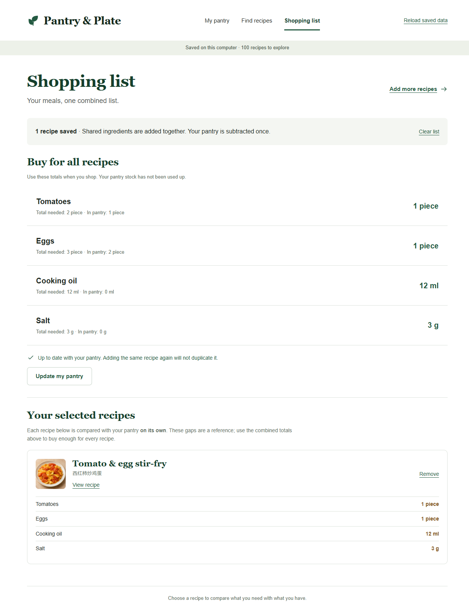

# H06 Windows candidate trial — 2026-11-25

Refs #41, #23, #24, #37. Tester: Hao (`fhhhz-todd`), with Codex assistance. **Candidate checks passed; final clean-machine / physically disconnected acceptance remains open.**

## Artifact and host

- Source SHA: `84ec45e65d8955cb3b8ce62a8ead49050bc86601`.
- Actions run: [45518306043](https://github.com/kekepepe/Smart-Recipe-Pantry-Planner/actions/runs/45518306043), artifact `14978318753`.
- File: `Pantry-and-Plate-1.0.0-dev-win-x64.exe` (152,948,852 bytes).
- SHA-256, independently matched against `SHA256SUMS.txt`: `cd26c242535f904d11d70cc904878d88f9da8387d03b82ff304acd03730d1487`.
- Windows 11 Home China, `10.0.26200`, x64. Existing developer workstation; app uses a newly created isolated profile and install directory.

## Executed checks

1. Downloaded the Actions artifact through authenticated GitHub API; checked `SOURCE_COMMIT.txt` and `Get-FileHash -Algorithm SHA256`.
2. NSIS installed successfully using `/S /currentuser /D=<isolated acceptance directory>\installed` (exit 0). This silent installation does not test SmartScreen/browser download prompts.
3. Launched the installed EXE through Playwright Electron with child PATH restricted to Windows System32. No external Node/server is needed by the installed application; Node is used only by the test driver.
4. Fresh profile: selected sample pantry, opened Tomato & egg stir-fry, verified bundled image loaded and generated shopping list. Snapshot contains 100 recipes. Displayed gaps: tomato 1 piece, egg 1 piece, oil 12 ml, salt 3 g. Captured screenshot.
5. Closed and relaunched the process: entire snapshot deep-equal, including pantry, selected recipe and shopping rows.
6. Unauthenticated loopback snapshot fetch returned 403. External renderer fetch was rejected by the application network policy.
7. On the isolated test profile, changed catalog version to a deliberate old-version fixture, closed and relaunched. Exactly one pre-upgrade backup was created; pantry, selection and shopping quantities were preserved.
8. Closed application, copied that backup to a new profile and relaunched. Upgrade/restore retained pantry, selection and shopping data.

Reproducible runner: [`scripts/verify-windows-candidate.mjs`](../../scripts/verify-windows-candidate.mjs). With a compatible source checkout whose Playwright dependencies are installed:

```powershell
$env:PANTRY_ACCEPTANCE_DIR = 'C:\PantryAcceptance'
node scripts/verify-windows-candidate.mjs
```

Expected input: installed candidate at `installed\Pantry & Plate.exe`. The runner creates unique profiles, preserves evidence, writes `acceptance-result.json` and `shopping-list.png`, and throws on failed assertions. It alters catalog metadata only in the test profile. No system network adapter/firewall change is made. The recorded run used existing Playwright dependencies from an independently installed review checkout; packaged SQLite was loaded through the installed Electron runtime for upgrade simulation.

## Source installation limitation

On Node 22.23.1, `npm ci --no-audit --no-fund` at the P06 source SHA failed: `better-sqlite3@13.2.0` invoked `node-gyp rebuild`, which could not find Visual Studio Build Tools. The candidate EXE nevertheless installed and ran successfully with its bundled runtime/native module. This is a source-development prerequisite to document/investigate, not evidence that the self-contained installer needs Visual Studio. No new build toolchain was installed for this trial.

## Remaining gates (not passed by this trial)

- Clean Windows VM/machine and physical network disconnection throughout install/first use.
- Browser download and actual unsigned-installer SmartScreen UX, without bypassing protection silently.
- Final integrated candidate (this artifact contains baseline features, not the unmerged V2 features).
- Published Release Windows asset SHA-256, source SHA and instructor download access.

The user confirmed no clean Windows environment is currently available and requested candidate evidence submission with final acceptance left pending. ChangPeng reviews H06; Mao archives both platforms. Keep #41 open until the remaining checks have real evidence.


